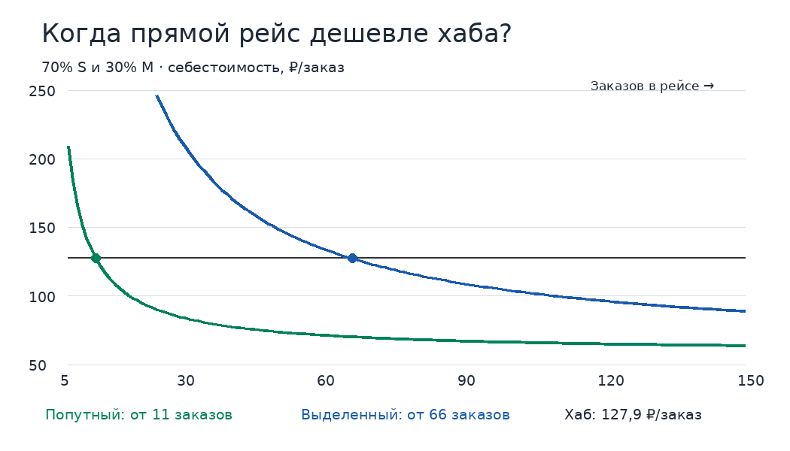
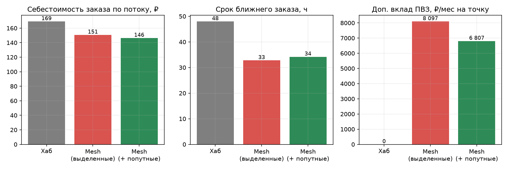
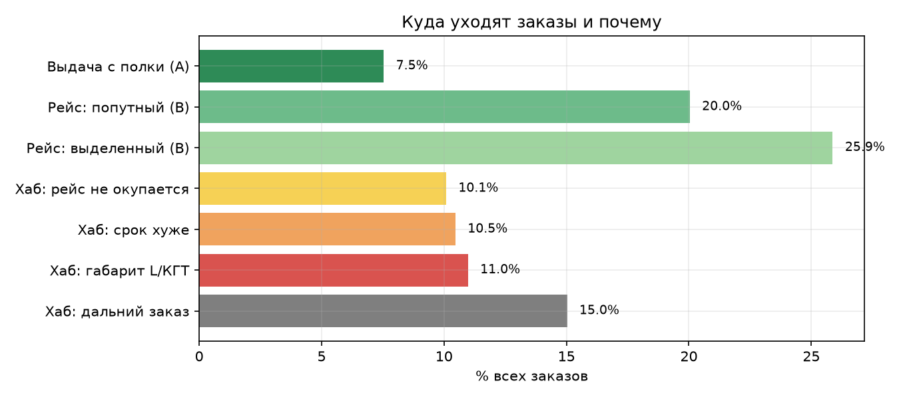
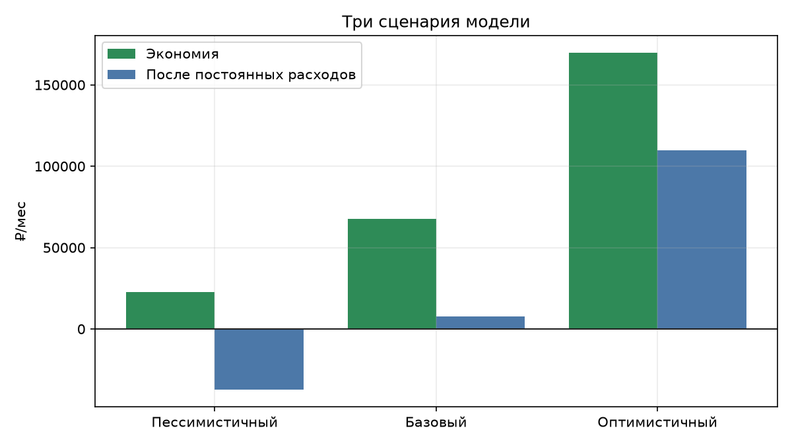
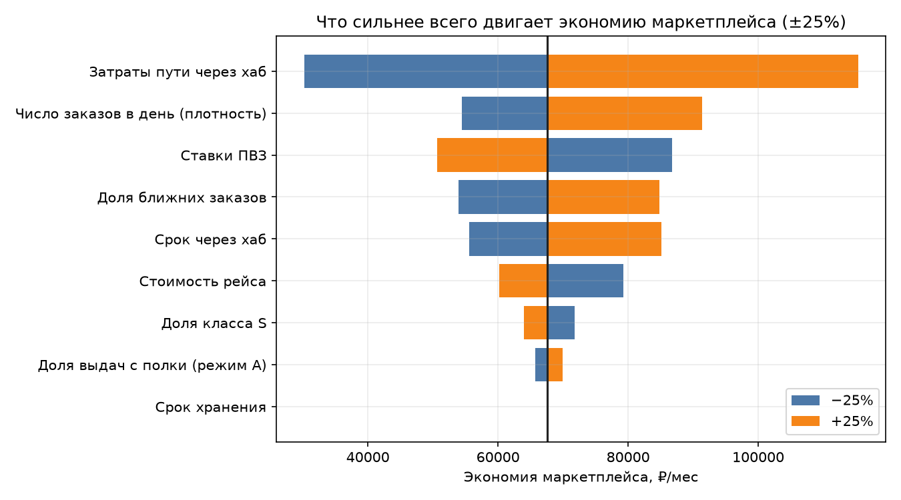
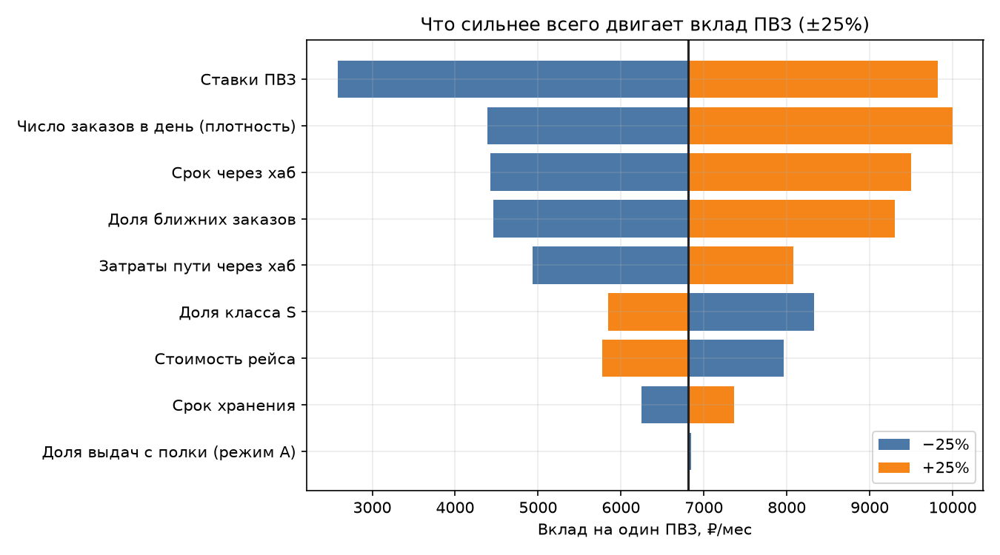
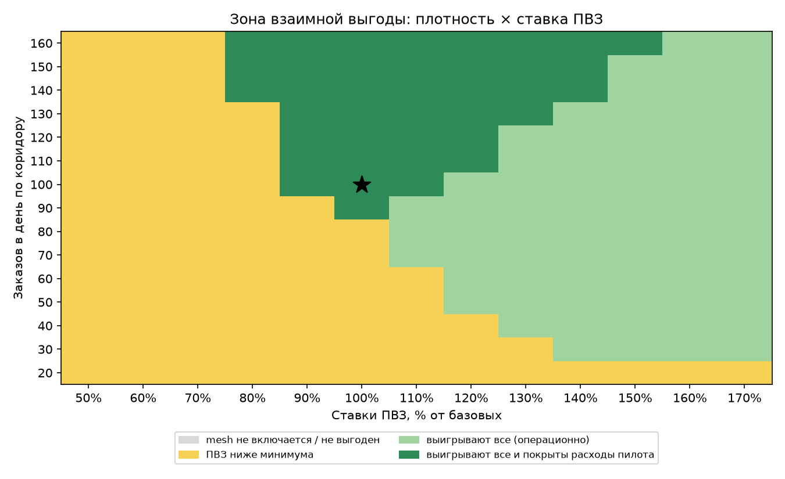

# Аналитика проекта: все расчёты и цифры в одном месте

> [!IMPORTANT]
> Все входные числа — **допущения команды**, а не тарифы RWB. Файл создаётся скриптом из кода (`core/`),
> поэтому цифры здесь всегда совпадают с расчётами. Пересборка: `make analytics`.

## Содержание

1. [Что сделано, простыми словами](#1-что-сделано-простыми-словами)
2. [Имитационная модель: что это и как устроена](#2-имитационная-модель-что-это-и-как-устроена)
3. [Допущения (все входные числа)](#3-допущения-все-входные-числа)
4. [Расчёты вручную: стоимость заказа и пороги](#4-расчёты-вручную-стоимость-заказа-и-пороги)
5. [Результаты симуляции](#5-результаты-симуляции)
6. [Выводы и что говорить жюри](#6-выводы-и-что-говорить-жюри)
7. [Ограничения модели](#7-ограничения-модели)
8. [Что допиливать (технически и аналитически)](#8-что-допиливать-технически-и-аналитически)
9. [Как воспроизвести](#9-как-воспроизвести)

---

## 1. Что сделано, простыми словами

Мы ответили на вопрос: **при каких условиях выгодно возить заказ между ПВЗ напрямую, а не через хаб, и кому это выгодно.**

1. **Посчитали стоимость одного заказа двумя способами** (через хаб и через mesh) для трёх размеров посылки.
   Это раздел [4](#4-расчёты-вручную-стоимость-заказа-и-пороги): формулы с подстановкой чисел.
2. **Нашли пороги.** Рейс между ПВЗ окупается, если в нём достаточно заказов: примерно 66 для отдельной машины
   и 11 при попутной загрузке (поток 70% S + 30% M).
3. **Построили имитационную модель:** программа создаёт ~3 000 случайных заказов за месяц, гонит каждый через обе схемы
   и считает деньги и сроки для четырёх сторон. Раздел [2](#2-имитационная-модель-что-это-и-как-устроена).
4. **Прогнали модель**: сравнение схем, три сценария, чувствительность к 9 параметрам, порог плотности, частота рейсов,
   карта «где выигрывают все». Раздел [5](#5-результаты-симуляции).
5. **Покрыли тестами:** 26 тестов проверяют, что код выдаёт числа из бизнес-модели.

### Где что лежит

| Что | Где | Как открыть / запустить |
| --- | --- | --- |
| **Этот файл** — вся аналитика | `ANALYTICS.md` | `make analytics` |
| Допущения (все входные числа) | `core/parameters.py` | Менять здесь, потом `make report` |
| Формулы стоимости, вклад ПВЗ, пороги | `core/economics.py` | `make breakeven` |
| **Имитационная модель** | `core/simulation.py` | `python -c "from core.simulation import simulate; from core.parameters import Params; print(simulate(Params()))"` |
| Чувствительность, сценарии, карта | `core/analysis.py` | — |
| Короткий отчёт с графиками | `reports/model_report.md`, `reports/img/` | `make report` |
| Все результаты в JSON (для интерфейса) | `reports/results.json`, `reports/experiments.json` | — |
| Бизнес-модель (текст, тарифы, риски) | `docs/business-model.md` | — |
| Тесты | `tests/` | `make test` |

---

## 2. Имитационная модель: что это и как устроена

**Совет специалиста WB про имитационную модель — это ровно то, что здесь построено.** Имитационная модель не выводит ответ одной формулой,
а *проигрывает* работу сети на случайных данных и измеряет итог. Так видны эффекты, которые формулой не поймать: заполнение рейсов,
ожидание отправки, нехватка места, влияние расписания.

### Из чего состоит

| Элемент | Как задан в модели |
| --- | --- |
| **Время** | 30 дней по часам; рейсы уходят в 8:00 по дням недели (0, 2, 4, 5) (пн = 0) |
| **Заказы (случайность)** | Пуассоновский поток в среднем 100 заказов в день; нагрузка выше в пт, сб, вс; время дня случайно |
| **Размер посылки (случайность)** | S 60%, M 27%, L 8%, КГТ 5% |
| **Расстояние (случайность)** | 85% заказов ближние (один коридор), остальные дальние |
| **Режим A** | 10% ближних заказов уже лежат в ПВЗ покупателя (случайно) |
| **Сеть** | 2 города, 4 ПВЗ, 1 хаб; ёмкость подсобки 200 УМ, резерв 15% |
| **Правило решения** | Для каждого заказа четыре фильтра: плотность района, габариты, срок, окупаемость рейса |
| **Рейсы** | Для каждого отправления модель сама выбирает лучший вариант: только попутная загрузка, один выделенный рейс, оба или хаб — по чистой экономии |
| **Что измеряет** | Себестоимость заказа, экономия, срок, вклад ПВЗ, доля заказов через mesh, причины ухода в хаб |

### Как проходит один прогон

1. Генерируется поток заказов (случайный, но воспроизводимый: фиксируется `seed`).
2. **Базовая схема:** каждый заказ едет через хаб, считается стоимость и срок.
3. **Mesh:** заказ проверяется по фильтрам (дальний, крупный, нет места, срок хуже, рейс не окупается — уходит в хаб).
   Прошедшие группируются по ближайшему рейсу; модель выбирает тип рейса так, чтобы чистая экономия была максимальной.
4. Сравнивается итог двух схем на **одних и тех же заказах**: это честное сравнение, а не «два разных мира».
5. Прогон повторяется на 5 разных `seed`, результат усредняется (так убирается случайный шум одного месяца).

### Как мы проверили, что модель не врёт

| Проверка | Результат |
| --- | --- |
| Контрольные числа (стоимость хаба и mesh, пороги) совпадают с ручным расчётом | Да, 26 тестов зелёные |
| Воспроизводимость: тот же `seed` даёт то же число | Да (тест) |
| Сумма причин ухода в хаб равна числу заказов | Да (тест воронки) |
| Крупные посылки и дальние заказы никогда не идут через mesh | Да (тесты) |
| Mesh никогда не дороже хаба по сумме | Да (тест на 3 seed) |
| Покупатель не получает срок хуже | Да (тест) |
| Разброс между прогонами | Коэффициент вариации экономии 2.5% (таблица в разделе [5.9](#59-разброс-между-прогонами)) |

### Что отвечать про модель на защите

- **«Что вы моделировали?»** Месяц работы коридора из двух городов, 4 ПВЗ и хаба: ~3 000 случайных заказов с разными размерами и временем,
  каждый заказ проигрывается в двух схемах.
- **«Откуда случайность?»** Поток заказов, их размер, расстояние, время суток, попадание товара на полку ПВЗ. Всё воспроизводимо по `seed`.
- **«Как проверили?»** Тесты на ручные расчёты, повтор на 5 seed, анализ чувствительности, три сценария.
- **«Что не моделируете?»** Раздел [7](#7-ограничения-модели).

---

## 3. Допущения (все входные числа)

Все числа ниже — допущения команды. Единственное место, где их меняют: `core/parameters.py`.

| ID | Параметр | Значение | Единица | Пояснение |
| --- | --- | ---: | --- | --- |
| A01 | `hub_proc` | 25.0 | ₽ | Обработка на хабе × k_оп |
| A02 | `hub_leg_seller` | 40.0 | ₽ | Плечо продавец → хаб × k_тр |
| A03 | `hub_last_mile` | 35.0 | ₽ | Последняя миля хаб → ПВЗ × k_тр |
| A04 | `hub_storage_rate` | 3.0 | ₽/УМ·день | Хранение на хабе (принято равным ПВЗ) |
| A05 | `hub_scale` | 1.0 | × | Множитель затрат хаба (для чувствительности) |
| A06 | `pvz_receive` | 10.0 | ₽ | Приёмка × k_оп |
| A07 | `pvz_storage_rate` | 3.0 | ₽/УМ·день | Хранение в ПВЗ |
| A08 | `pvz_assemble` | 21.0 | ₽ | Сборка × k_оп |
| A09 | `mesh_other` | 10.0 | ₽ | Прочее: возвраты, вывоз, резерв × k_оп (затрата маркетплейса) |
| A10 | `pvz_fee_scale` | 1.0 | × | Множитель ставок ПВЗ (приёмка, хранение, сборка) |
| A11 | `labor_rate_hour` | 400.0 | ₽/час | Труд сотрудника ПВЗ |
| A12 | `pvz_space_per_um_day` | 1.667 | ₽/УМ·день | Расходники и место |
| A13 | `storage_days` | 3.0 | дней | Средний срок хранения |
| A14 | `trip_km` | 240.0 | км | Пробег рейса туда и обратно |
| A15 | `cost_per_km` | 12.0 | ₽/км | Стоимость км |
| A16 | `trip_hours` | 6.0 | ч | Время водителя на рейс |
| A17 | `driver_rate` | 270.0 | ₽/час | Ставка водителя |
| A18 | `along_km` | 40.0 | км | Крюк при попутной загрузке |
| A19 | `along_hours` | 1.0 | ч | Остановка и погрузка при попутной загрузке |
| A20 | `trip_cost_scale` | 1.0 | × | Множитель стоимости рейса (для чувствительности) |
| A21 | `vehicle_um` | 300.0 | УМ | Вместимость выделенной машины |
| A22 | `along_um` | 60.0 | УМ | Свободное место на уже идущем рейсе |
| A23 | `along_available` | True |  | Есть ли попутные рейсы |
| A24 | `eta_hub_h` | 48.0 | ч | Срок через хаб, ближний поток |
| A25 | `eta_leg_h` | 5.0 | ч | Путь и выдача после отправки рейса |
| A26 | `eta_shelf_h` | 4.0 | ч | Срок режима A (с полки) |
| A27 | `delta_t_h` | 0.0 | ч | Допуск по сроку (0 = не хуже хаба) |
| A28 | `trip_days` | (0, 2, 4, 5) |  | Дни недели рейсов (0 = пн): 4 рейса в неделю |
| A29 | `dep_hour` | 8.0 | ч | Час отправления рейса |
| A30 | `days` | 30 | дней | Горизонт симуляции |
| A31 | `orders_per_day` | 100.0 | заказов/день | Все заказы коридора |
| A32 | `nearby_share` | 0.85 | доля | Доля ближних заказов (один коридор, до 300 км) |
| A33 | `share_S` | 0.6 | доля | Доля класса S |
| A34 | `share_M` | 0.27 | доля | Доля класса M |
| A35 | `share_L` | 0.08 | доля | Доля класса L |
| A36 | `share_KGT` | 0.05 | доля | Доля КГТ и особых товаров |
| A37 | `shelf_hit_rate` | 0.1 | доля | Доля заказов, которые уже лежат в ПВЗ покупателя (режим A) |
| A38 | `pvz_count` | 4 | шт | ПВЗ в пилоте |
| A39 | `pvz_capacity_um` | 200.0 | УМ | Ёмкость подсобки |
| A40 | `pvz_reserve` | 0.15 | доля | Резерв места под обычную выдачу |
| A41 | `trunk_stub` | 120.0 | ₽ | Заглушка магистрали для дальних заказов (одинакова в обеих схемах) |
| A42 | `fixed_cost_month` | 60000.0 | ₽/мес | Постоянные расходы пилота |
| A43 | `pvz_min_month` | 5000.0 | ₽/мес на ПВЗ | Минимальный вклад, при котором ПВЗ согласен |
| A44 | `seller_unit_cost` | 600.0 | ₽ | Средняя себестоимость единицы товара |
| A45 | `capital_rate_year` | 0.2 | доля/год | Стоимость замороженного капитала продавца |
| A46 | `seller_commission` | 0.15 | доля от цены | Комиссия маркетплейса (одинакова в обеих схемах) |
| A47 | `seller_logistics_fee` | 60.0 | ₽ | Тариф логистики продавцу для класса S × k_тр (одинаков в обеих схемах) |
| A48 | `return_rate` | 0.05 | доля | Доля возвратов |

**Классы габаритов.** УМ — условная единица места. Коэффициенты умножают базовую стоимость операций и перевозки:

| Класс | УМ | k_оп (операции) | k_тр (перевозка) | Минут труда ПВЗ | В mesh в пилоте |
| --- | ---: | ---: | ---: | ---: | --- |
| S | 1 | 1.0 | 1.0 | 3 | да |
| M | 3 | 1.3 | 1.5 | 4 | да, при месте |
| L | 8 | 1.8 | 2.5 | 6 | нет, через хаб |
| КГТ / особые | — | — | — | — | нет, через хаб |

---

## 4. Расчёты вручную: стоимость заказа и пороги

### 4.1. Затраты через хаб, ₽ на заказ

| Класс | Обработка 25×k_оп | Хранение 3×УМ×3 дня | Плечо до хаба 40×k_тр | Последняя миля 35×k_тр | Итого |
| --- | ---: | ---: | ---: | ---: | ---: |
| S | 25.0 | 9.0 | 40.0 | 35.0 | **109.0** |
| M | 32.5 | 27.0 | 60.0 | 52.5 | **172.0** |
| L | 45.0 | 72.0 | 100.0 | 87.5 | **304.5** |

Пример для S: 25 + 9 + 40 + 35 = **109 ₽**.

### 4.2. Затраты mesh (без стоимости рейса), ₽ на заказ

| Класс | Приёмка 10×k_оп | Хранение 3×УМ×3 дня | Сборка 21×k_оп | Прочее 10×k_оп | Итого |
| --- | ---: | ---: | ---: | ---: | ---: |
| S | 10.0 | 9.0 | 21.0 | 10.0 | **50.0** |
| M | 13.0 | 27.0 | 27.3 | 13.0 | **80.3** |
| L | 18.0 | 72.0 | 37.8 | 18.0 | **145.8** |

Пример для S: 10 + 9 + 21 + 10 = **50 ₽**.

### 4.3. Экономия до учёта рейса

| Класс | Хаб, ₽ | Mesh без рейса, ₽ | Экономия, ₽ | Экономия на 1 УМ, ₽ |
| --- | ---: | ---: | ---: | ---: |
| S | 109.0 | 50.0 | **59.0** | 59.0 |
| M | 172.0 | 80.3 | **91.7** | 30.6 |
| L | 304.5 | 145.8 | **158.7** | 19.8 |

Экономия на единицу места падает с размером посылки: поэтому крупные классы L и КГТ в пилоте идут через хаб.

### 4.4. Вклад ПВЗ с заказа (хранение 3 дня)

| Класс | Выручка ПВЗ, ₽ | Труд, ₽ | Место и расходники, ₽ | Вклад, ₽ | Вклад на УМ·день, ₽ |
| --- | ---: | ---: | ---: | ---: | ---: |
| S | 40.0 | −20.0 | −5.0 | **15.0** | 5.0 |
| M | 67.3 | −26.7 | −15.0 | **25.6** | 2.8 |
| L | 127.8 | −40.0 | −40.0 | **47.8** | 2.0 |

Выручка ПВЗ = приёмка + хранение + сборка. Труд = минуты × 400 ₽/час ÷ 60.

### 4.5. Стоимость рейса

| Статья | ₽ |
| --- | ---: |
| Пробег 240 км × 12 ₽/км | 2 880 |
| Водитель 6 ч × 270 ₽/ч | 1 620 |
| **Выделенный рейс** | **4 500** |
| Попутная загрузка: крюк 40 км × 12 + остановка 1 ч × 270 | **750** |

### 4.6. Пороги окупаемости рейса

Рейс окупается, если **сумма экономии заказов в рейсе не меньше стоимости рейса**. Минимум заказов в рейсе:

| Состав рейса | Выделенный рейс | Попутная загрузка |
| --- | ---: | ---: |
| Только класс S | 77 | 13 |
| Только класс M | 50 | 9 |
| Поток 70% S + 30% M | 66 | 11 |

Стоимость заказа S от числа заказов в выделенном рейсе (рейс 4 500 ₽ делится на заказы):

| Заказов S в рейсе | Mesh, ₽/заказ | Хаб, ₽/заказ | Что выгоднее | Эффект рейса, ₽ |
| --- | ---: | ---: | ---: | ---: |
| 30 | 200.0 | 109.0 | хаб | −2 730 |
| 60 | 125.0 | 109.0 | хаб | −960 |
| 77 | 108.4 | 109.0 | mesh | 43 |
| 100 | 95.0 | 109.0 | mesh | 1 400 |
| 150 | 80.0 | 109.0 | mesh | 4 350 |



### 4.7. Ручная проверка пилота (упрощённо)

Один коридор, 4 рейса в неделю, 4,3 недели в месяц, постоянные расходы пилота 60 000 ₽/мес. Каждый рейс везёт одинаковое число заказов.

| Заказов в рейсе | Выделенные, ₽/мес | После пост. расходов | Попутные, ₽/мес | После пост. расходов |
| --- | ---: | ---: | ---: | ---: |
| 40 | −30 059 | −90 059 | 34 441 | −25 559 |
| 66 | 713 | −59 287 | 65 213 | 5 213 |
| 100 | 40 953 | −19 047 | 105 453 | 45 453 |
| 120 | 64 624 | 4 624 | 129 124 | 69 124 |
| 150 | 100 130 | 40 130 | 164 630 | 104 630 |

Это упрощённая оценка. Точный результат даёт симуляция (раздел 5): там заказы случайны, часть уходит в хаб по сроку, габариту и месту.

---

## 5. Результаты симуляции

Базовые условия: 30 дней, ≈ 100 заказов в день, 4 ПВЗ, 4 рейса в неделю. Среднее по 5 seed.

### 5.1. Сравнение схем (главная таблица)

| Показатель | Хаб (база) | Mesh: только выделенные рейсы | Mesh: + попутная загрузка |
| --- | ---: | ---: | ---: |
| Себестоимость заказа по потоку, ₽ | 169.3 | 150.8 | 146.5 |
| Экономия маркетплейса, ₽/мес | — | 54 801 | 67 607 |
| Экономия, % к базе | — | 10.9% | 13.5% |
| После постоянных расходов (60 000 ₽/мес) | — | −5 199 | 7 607 |
| Доля заказов через mesh | 0% | 59.9% | 53.5% |
| Срок ближнего заказа, ч | 48 | 32.8 | 34.2 |
| Цена доставки для покупателя | без изменений | без изменений | без изменений |
| Доп. вклад ПВЗ, ₽/мес на точку | 0 | 8 097 | 6 807 |
| Рейсов в месяц: выделенных / попутных | — | 14 / 0 | 6 / 10 |
| Заказов в выделенном рейсе (среднее) | — | 103 | 121 |
| Затраты на рейсы, ₽/мес | — | 67 659 | 36 529 |



Почему при попутной загрузке доля mesh-заказов ниже: модель максимизирует **экономию**, а не охват. Заказы, которые не окупают отдельную машину
и не помещаются на попутный рейс, остаются на хабе.

### 5.2. Результат по четырём сторонам

| Сторона | Результат | Откуда |
| --- | --- | --- |
| **Маркетплейс** | Экономия 67 607 ₽/мес (13.5% к себестоимости потока); примерно 53% заказов (≈ 1 604 в месяц) идут мимо хаба | Разделы 5.1, 5.3 |
| **ПВЗ** | +6 807 ₽/мес на точку (≥ минимума 5 000 ₽) | Раздел 4.4 |
| **Покупатель** | Цена та же; срок ближнего заказа 48 → 34.2 ч (в среднем по ближним заказам) | Раздел 5.1 |
| **Продавец** | По тарифам первые 3 дня платит как в базе (Δ = 0); выигрыш в замороженном капитале ≈ 476 ₽/мес всего по потоку; рост конверсии не моделируется | Раздел 7 |

Пример маржи продавца (одинаков в обеих схемах в первые 3 дня): цена 1 200 − себестоимость 650
− комиссия 15% (180) − логистика 60 = **310 ₽**.

### 5.3. Куда уходят заказы и почему



| Причина | Заказов, % потока |
| --- | ---: |
| Выдача с полки (режим A) | 7.5% |
| Рейс попутный (режим B) | 20.0% |
| Рейс выделенный (режим B) | 25.9% |
| Хаб: дальний заказ | 15.0% |
| Хаб: габарит L/КГТ | 11.0% |
| Хаб: срок mesh хуже хаба | 10.5% |
| Хаб: рейс не окупается | 10.1% |
| Хаб: нет места / зона RED | 0.0% |

Около половины потока остаётся на хабе: для него mesh невыгоден. Это показывает **границы применимости** схемы.

### 5.4. Три сценария

| Сценарий | Зона | Экономия, ₽/мес | % к базе | После пост. расходов | Доля mesh | Срок, ч | Вклад ПВЗ на точку |
| --- | --- | ---: | ---: | ---: | ---: | ---: | ---: |
| Пессимистичный | YELLOW | 22 581 | 6.3% | −37 419 | 42.7% | 36.8 | 5 371 |
| Базовый | GREEN | 67 607 | 13.5% | 7 607 | 53.5% | 34.2 | 6 807 |
| Оптимистичный | GREEN | 169 914 | 25.6% | 109 914 | 68.8% | 30.7 | 8 481 |

Пессимистичный: рейс +25%, затраты хаба −15%, заказов −25%, ближних −10%, ставки ПВЗ +15%, режим A вдвое реже. Оптимистичный: зеркально.



### 5.5. Чувствительность (каждый параметр ±25%)

**Экономия маркетплейса, ₽/мес** (база 67 607):

| Параметр | −25% | +25% | Размах |
| --- | ---: | ---: | ---: |
| Затраты пути через хаб | 30 192 | 115 378 | 85 186 |
| Число заказов в день (плотность) | 54 470 | 91 371 | 36 901 |
| Ставки ПВЗ | 86 764 | 50 611 | 36 153 |
| Доля ближних заказов | 53 899 | 84 839 | 30 941 |
| Срок через хаб | 55 566 | 85 115 | 29 549 |
| Стоимость рейса | 79 227 | 60 170 | 19 058 |
| Доля класса S | 71 827 | 64 023 | 7 805 |
| Доля выдач с полки (режим A) | 65 742 | 69 941 | 4 198 |
| Срок хранения | 67 607 | 67 607 | 0 |



**Вклад ПВЗ на точку, ₽/мес** (база 6 807):

| Параметр | −25% | +25% | Размах |
| --- | ---: | ---: | ---: |
| Ставки ПВЗ | 2 581 | 9 824 | 7 243 |
| Число заказов в день (плотность) | 4 385 | 9 999 | 5 614 |
| Срок через хаб | 4 423 | 9 498 | 5 075 |
| Доля ближних заказов | 4 458 | 9 301 | 4 843 |
| Затраты пути через хаб | 4 938 | 8 083 | 3 144 |
| Доля класса S | 8 324 | 5 846 | 2 479 |
| Стоимость рейса | 7 963 | 5 770 | 2 193 |
| Срок хранения | 6 248 | 7 365 | 1 116 |
| Доля выдач с полки (режим A) | 6 845 | 6 798 | 47 |



Сильнее всего результат зависит от «Затраты пути через хаб» (размах 85 186 ₽/мес) и «Число заказов в день (плотность)» (36 901 ₽/мес).

### 5.6. Порог плотности: при скольких заказах в день схема работает

| Заказов в день | Зона | Экономия, ₽/мес | После пост. расходов | Доля mesh | Вклад ПВЗ на точку |
| --- | ---: | ---: | ---: | ---: | ---: |
| 20 | YELLOW | 13 777 | −46 223 | 63.1% | 1 721 |
| 40 | YELLOW | 34 549 | −25 451 | 59.2% | 3 105 |
| 60 | GREEN | 46 751 | −13 249 | 52.6% | 3 919 |
| 80 | GREEN | 55 857 | −4 143 | 48.0% | 4 635 |
| 100 | GREEN | 67 607 | 7 607 | 53.5% | 6 807 |
| 120 | GREEN | 86 087 | 26 087 | 60.4% | 9 596 |
| 140 | GREEN | 107 297 | 47 297 | 60.3% | 11 191 |
| 160 | GREEN | 131 220 | 71 220 | 62.8% | 13 579 |

Пилот выходит в плюс после постоянных расходов (60 000 ₽/мес) между 80 и 100 заказами в день по коридору; ниже этого порога схема не окупается.
Это критерий выбора района для запуска: берём коридоры с плотностью выше порога.

### 5.7. Частота рейсов

| Рейсов | Экономия, ₽/мес | После пост. расходов | Доля mesh | Срок ближнего заказа, ч | Вклад ПВЗ на точку |
| --- | ---: | ---: | ---: | ---: | ---: |
| 2 в неделю | 45 079 | −14 921 | 34.8% | 38.8 | 4 523 |
| 3 в неделю | 57 557 | −2 443 | 46.3% | 36.4 | 5 955 |
| 4 в неделю (база) | 67 607 | 7 607 | 53.5% | 34.2 | 6 807 |
| 5 в неделю | 74 150 | 14 150 | 55.4% | 32.5 | 6 934 |
| каждый день | 85 183 | 25 183 | 58.0% | 29.0 | 6 942 |

Чаще рейсы, значит меньше ожидание и больше заказов проходят по сроку, поэтому растут экономия и доля mesh.
**Оговорка:** в модели отправление оплачивается только если рейс состоялся, поэтому частое расписание «ничего не стоит». В реальности постоянный
график требует резерва транспорта: перед использованием вывода нужно добавить постоянные затраты на каждое запланированное отправление.

### 5.8. Карта взаимной выгоды

⬜ mesh не включается · 🟨 ПВЗ ниже минимума · 🟩 выигрывают все (операционно) · 🟢 выигрывают все и покрыты расходы пилота · ⭐ базовая точка

| Заказов в день ↓ / Ставки ПВЗ → | 50% | 60% | 70% | 80% | 90% | 100% | 110% | 120% | 130% | 140% | 150% | 160% | 170% |
| --- | :---: | :---: | :---: | :---: | :---: | :---: | :---: | :---: | :---: | :---: | :---: | :---: | :---: |
| 160 | 🟨 | 🟨 | 🟨 | 🟢 | 🟢 | 🟢 | 🟢 | 🟢 | 🟢 | 🟢 | 🟢 | 🟩 | 🟩 |
| 150 | 🟨 | 🟨 | 🟨 | 🟢 | 🟢 | 🟢 | 🟢 | 🟢 | 🟢 | 🟢 | 🟩 | 🟩 | 🟩 |
| 140 | 🟨 | 🟨 | 🟨 | 🟢 | 🟢 | 🟢 | 🟢 | 🟢 | 🟢 | 🟢 | 🟩 | 🟩 | 🟩 |
| 130 | 🟨 | 🟨 | 🟨 | 🟨 | 🟢 | 🟢 | 🟢 | 🟢 | 🟢 | 🟩 | 🟩 | 🟩 | 🟩 |
| 120 | 🟨 | 🟨 | 🟨 | 🟨 | 🟢 | 🟢 | 🟢 | 🟢 | 🟩 | 🟩 | 🟩 | 🟩 | 🟩 |
| 110 | 🟨 | 🟨 | 🟨 | 🟨 | 🟢 | 🟢 | 🟢 | 🟢 | 🟩 | 🟩 | 🟩 | 🟩 | 🟩 |
| 100 | 🟨 | 🟨 | 🟨 | 🟨 | 🟢 | 🟢⭐ | 🟢 | 🟩 | 🟩 | 🟩 | 🟩 | 🟩 | 🟩 |
| 90 | 🟨 | 🟨 | 🟨 | 🟨 | 🟨 | 🟢 | 🟩 | 🟩 | 🟩 | 🟩 | 🟩 | 🟩 | 🟩 |
| 80 | 🟨 | 🟨 | 🟨 | 🟨 | 🟨 | 🟨 | 🟩 | 🟩 | 🟩 | 🟩 | 🟩 | 🟩 | 🟩 |
| 70 | 🟨 | 🟨 | 🟨 | 🟨 | 🟨 | 🟨 | 🟩 | 🟩 | 🟩 | 🟩 | 🟩 | 🟩 | 🟩 |
| 60 | 🟨 | 🟨 | 🟨 | 🟨 | 🟨 | 🟨 | 🟨 | 🟩 | 🟩 | 🟩 | 🟩 | 🟩 | 🟩 |
| 50 | 🟨 | 🟨 | 🟨 | 🟨 | 🟨 | 🟨 | 🟨 | 🟩 | 🟩 | 🟩 | 🟩 | 🟩 | 🟩 |
| 40 | 🟨 | 🟨 | 🟨 | 🟨 | 🟨 | 🟨 | 🟨 | 🟨 | 🟩 | 🟩 | 🟩 | 🟩 | 🟩 |
| 30 | 🟨 | 🟨 | 🟨 | 🟨 | 🟨 | 🟨 | 🟨 | 🟨 | 🟨 | 🟩 | 🟩 | 🟩 | 🟩 |
| 20 | 🟨 | 🟨 | 🟨 | 🟨 | 🟨 | 🟨 | 🟨 | 🟨 | 🟨 | 🟨 | 🟨 | 🟨 | 🟨 |

«Выигрывают все»: экономия маркетплейса больше нуля, вклад ПВЗ не ниже 5 000 ₽/мес, цена и срок покупателя не хуже, продавец не платит больше.
Таких ячеек 109 из 195, из них 39 покрывают постоянные расходы пилота.



### 5.9. Разброс между прогонами

| Прогон (seed) | Заказов | Экономия, ₽/мес | % к базе | Доля mesh | После пост. расходов |
| --- | ---: | ---: | ---: | ---: | ---: |
| 1 | 2873 | 68 212 | 13.1% | 51.0% | 8 212 |
| 2 | 2738 | 64 217 | 13.1% | 52.7% | 4 217 |
| 3 | 2780 | 68 865 | 13.9% | 56.1% | 8 865 |
| 4 | 2826 | 68 646 | 13.7% | 50.7% | 8 646 |
| 5 | 2793 | 68 097 | 13.5% | 56.9% | 8 097 |

Среднее 67 607 ₽/мес, минимум 64 217, максимум 68 865; коэффициент вариации 2.5%.
Один прогон случаен, но разброс небольшой: поэтому везде используется среднее по 5 seed.

---

## 6. Выводы и что говорить жюри

1. **Mesh выгоден только на ближнем потоке и при достаточной плотности.** Экономия 13.5% по всему потоку, срок ближнего заказа 48 → 34 ч при той же цене.
2. **Порог окупаемости рейса:** ≈ 66 заказов для отдельной машины и ≈ 11 при попутной загрузке (поток 70/30). Одно расстояние, разная загрузка — разный ответ.
3. **Пилот в базовом случае на грани:** 7 607 ₽/мес после постоянных расходов. Без попутной загрузки он убыточен (−5 199 ₽/мес).
4. **Диапазон исходов:** от −37 419 (пессимистичный) до 109 914 ₽/мес (оптимистичный). Поэтому запуск начинается с проверки реальных затрат хаба — это главная неопределённость.
5. **Все четыре стороны не проигрывают** в зоне взаимной выгоды; зона нарисована на карте (5.8), это критерий выбора коридоров для тиражирования.
6. **Честные границы:** крупногабарит, редкий товар, малый поток и дальняя доставка остаются на хабе.

---

## 7. Ограничения модели

- Эффект конверсии и снижения возвратов у продавца не моделируется (нет данных): выгода продавца занижена.
- Бонусы и штрафы ПВЗ (+10% за срок, +5% за продажу с полки) в симуляции выключены; на маркетплейс они добавят расходы.
- Возвраты, неликвид и вечерний пик описаны в бизнес-модели и сценариях MVP, но не входят в симуляцию потока.
- Один коридор, зона считается один раз на весь период. Нет спроса по отдельным SKU.
- Ёмкость подсобки учтена агрегатно (общий коэффициент), а не по каждому ПВЗ и дню.
- Стоимость хранения на хабе принята равной ставке ПВЗ.
- Расписание рейсов бесплатно: оплачиваются только состоявшиеся рейсы (см. оговорку в 5.7).
- **Главное:** стоимость пути через хаб (109 ₽ для S) — допущение; результат сильнее всего зависит именно от неё.

---

## 8. Что допиливать (технически и аналитически)

Приоритет: сверху вниз. Первые три пункта дают больше всего пользы для оценки модели и защиты.

| № | Что | Зачем | Где менять |
| --- | --- | --- | --- |
| 1 | **Подставить реальные данные** (тарифы хаба, стоимость рейса, ставки ПВЗ), если организаторы их дадут | Главная неопределённость модели | `core/parameters.py` |
| 2 | **Случайные сбои:** срыв рейса (вероятность), задержки, возвраты (5%) в симуляции | Сделать модель стохастической по-настоящему; даст сценарий «ошибка в логистике» в цифрах | `core/simulation.py` |
| 3 | **Постоянные затраты на расписание** (стоимость запланированного, но порожнего рейса) | Убрать оговорку 5.7, получить оптимальную частоту рейсов | `core/simulation.py` |
| 4 | **Спрос по SKU и прогноз размещения:** какой товар и в какой ПВЗ класть заранее | Сделать режим A обоснованным, а не заданным процентом | `core/simulation.py`, новый `core/demand.py` |
| 5 | **Ёмкость по каждому ПВЗ и дню**, вечерний пик | Честный учёт места и очередей | `core/simulation.py` |
| 6 | **Несколько коридоров** и пересчёт зон по скользящему окну | Отражает логику тиражирования | `core/simulation.py`, `core/analysis.py` |
| 7 | **Бонусы и штрафы ПВЗ** в расчёте | Полная экономика ПВЗ | `core/economics.py` |
| 8 | **Эффект конверсии продавца** (параметр, диапазон) | Выгода продавца пока занижена | `core/economics.py` |
| 9 | **Решатель одного заказа** `core/solver.py` и `plan_trip()` | Нужен API (см. ТЗ backend) | новый файл + тесты |
| 10 | **Оптимизация расписания:** какие дни недели и часы лучше | Использовать модель как инструмент решений | `core/analysis.py` |

---

## 9. Как воспроизвести

```bash
pip install -r requirements.txt
make test         # 26 тестов
make breakeven    # пороги и стоимость заказа (раздел 4)
make report       # симуляция, графики, reports/results.json, reports/model_report.md
make analytics    # этот файл + reports/experiments.json
```

Чтобы поменять допущение: правка в `core/parameters.py`, затем `make report && make analytics`. Все таблицы и графики пересчитаются сами.
