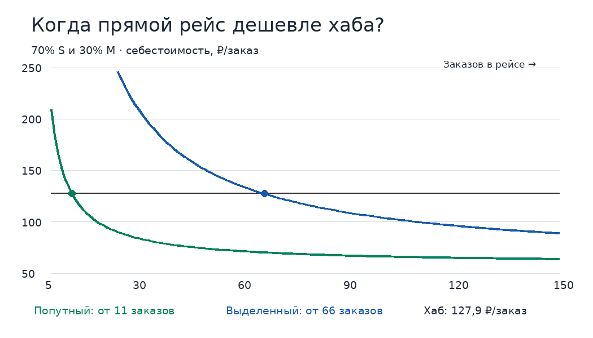

# Mesh-доставка с хранением в ПВЗ: бизнес-модель

[](#история-версий)
[](#)
[](#17-допущения-что-нужно-заменить-реальными-данными)

**Проект:** rwbhak · студенческий хакатон Университета RWB и ПГТУ, 25–26 ноября 2026  
**Статус:** выверенная финансово-логистическая модель (версия 0.3) для защиты и интеграции в MVP

> [!IMPORTANT]
> Все ставки, тарифы и параметры потока в документе — **согласованные допущения команды**, а не внутренние тарифы RWB. Они заданы в разумных порядках величин, чтобы сравнить классическую хабовую схему и mesh на одних и тех же заказах. Все константы вынесены в конфиг `core/parameters.py` и меняются без переписывания логики.

---

## Кратко

**Идея.** ПВЗ становится микро-складом ходовых товаров. Заказ внутри одной зоны выдаётся с полки ПВЗ (Режим A) или едет напрямую ПВЗ → ПВЗ (Режим B), минуя хаб и магистраль. Всё остальное идёт через хаб как сейчас (Режим C). Mesh включается только при одновременном прохождении фильтров: **плотность района, габариты и место, срок, окупаемость рейса**.

| Вопрос | Ответ модели (поток 70% S + 30% M) |
| --- | --- |
| Когда mesh выгоднее хаба? | Когда сумма экономии заказов в рейсе покрывает стоимость рейса |
| Средняя себестоимость через хаб | **127,90 ₽/заказ** (S = 109 ₽, M = 172 ₽) |
| Средняя экономия mesh до рейса | **68,81 ₽/заказ** (S = 59,00 ₽, M = 91,70 ₽) |
| Порог выделенного рейса (`4 500 ₽`) | **≥ 66 заказов** (или **≥ 77** при 100% S) |
| Порог попутной загрузки (`750 ₽`) | **≥ 11 заказов** (ниже в 6 раз) |
| Чистый вклад ПВЗ с заказа S / M | **+15,00 ₽ / +25,60 ₽** (без учёта бонусов за SLA) |
| Экономика продавца (чек 1 500 ₽, S) | **+472,50 ₽** чистой прибыли (идентично хабу, но быстрее оборот) |
| Окупаемость пилота (пост. расходы `60 000 ₽/мес`) | От **~116 заказов/рейс** (выделенный) или **~62 заказов/рейс** (попутный) |

---

## Содержание

1. [Проблема и целевая метрика](#1-проблема-и-целевая-метрика)
2. [Гипотеза и её граница](#2-гипотеза-и-её-граница)
3. [Решение: три режима и четыре фильтра](#3-решение-три-режима-и-четыре-фильтра)
4. [Габариты заказа и вместимость](#4-габариты-заказа-и-вместимость)
5. [Фильтр 1: плотность района](#5-фильтр-1-плотность-района)
6. [Фильтр 2: срок доставки](#6-фильтр-2-срок-доставки)
7. [Участники и стимулы](#7-участники-и-стимулы)
8. [Тарифы, комиссии и расчёты между сторонами](#8-тарифы-комиссии-и-расчёты-между-сторонами)
9. [Юнит-экономика заказа (Маркетплейс и Продавец)](#9-юнит-экономика-заказа-маркетплейс-и-продавец)
10. [Экономика ПВЗ](#10-экономика-пвз)
11. [Экономика пилота для маркетплейса](#11-экономика-пилота-для-маркетплейса)
12. [Неликвид, возвраты, сбои](#12-неликвид-возвраты-сбои)
13. [Критерий успеха пилота](#13-критерий-успеха-пилота)
14. [План пилота](#14-план-пилота)
15. [Риски и способы закрытия](#15-риски-и-способы-закрытия)
16. [Масштабирование](#16-масштабирование)
17. [Допущения (конфиг `core/parameters.py`)](#17-допущения-конфиг-coreparameterspy)

---

## 1. Проблема и целевая метрика

Маркетплейс упирается в три ограничения одновременно:

- **Хабы перегружены** — площади хранения растут медленнее потока, строительство новых мощностей требует времени и капитальных затрат.
- **Магистраль дорожает** — каждое плечо `город → хаб → город` оплачивается независимо от реальной географии заказа.
- **Локальный поток делает лишний круг** — в крупных городах и соседних агломерациях продавец и покупатель находятся в одном кластере, но товар всё равно едет на хаб и обратно.

**Целевая метрика верхнего уровня:** средняя себестоимость одного выданного заказа (`₽/заказ`) по всему потоку — с учётом заказов через хаб, затрат на ПВЗ, локальных рейсов, возвратов и списаний/вывоза неликвида.

**Вторичные метрики:**
- снижение загрузки хаба (`%` по объёму УМ);
- доля заказов, обошедших хаб (`%`);
- доля выдач в срок (`SLA ≥ базового`);
- операционная прибыль ПВЗ (`₽/мес`);
- чистая маржа продавца (`₽/заказ` и оборачиваемость капитала);
- **GMV** (должен остаться неизменным — мы оптимизируем логистическую себестоимость без ухудшения клиентского опыта).

---

## 2. Гипотеза и её граница

**Гипотеза:** размещение ходового ассортимента в подсобках ПВЗ и прямая доставка ПВЗ → ПВЗ без заезда на хаб снижают себестоимость заказа и разгружают хабы при сохранении сроков и цены для покупателя.

**Граница гипотезы:** в пилоте mesh рассматривается только на **ближнем плече — внутри города и между 2–3 соседними городами (до 300 км по дороге)**. Дальние межрегиональные перевозки остаются в классической магистрально-хабовой схеме.

При этом расстояние — лишь ограничитель зоны поиска. Решение по конкретному заказу/рейсу принимают **четыре фильтра**:

| № | Фильтр | Условие прохождения |
| --- | --- | --- |
| 1 | **Плотность района** | Поток заказов по коридору достаточен, чтобы рейсы не ходили полупустыми |
| 2 | **Габариты и место** | Товар класса `S` или `M` (без особых условий), есть свободные УМ в ПВЗ и машине |
| 3 | **Срок доставки** | Ожидаемый срок mesh не хуже срока доставки через хаб (`eta_mesh ≤ eta_hub`) |
| 4 | **Окупаемость рейса** | Суммарная экономия всех заказов в рейсе покрывает стоимость рейса |

> **Важный тезис для защиты:** даже на 30 км отдельная машина ради 5 посылок убыточна. Поэтому система не «включает mesh на весь регион», а проверяет экономику и SLA на каждый конкретный рейс и заказ.

---

## 3. Решение: три режима и четыре фильтра

ПВЗ работает в гибридном формате: основная зона выдачи + выделенная зона микро-хранения ходовых SKU.

| Режим | Условие срабатывания | Операционный цикл |
| --- | --- | --- |
| **A. Выдача с полки** | Товар лежит в ПВЗ покупателя | Резерв → сборка в ПВЗ → выдача. Перевозки нет, срок минимальный (`≤ 4 ч`) |
| **B. Прямой рейс ПВЗ → ПВЗ** | Товар в соседнем ПВЗ в пределах 300 км, пройдены все 4 фильтра | Сборка в ПВЗ-отправителе → рейс → приёмка и выдача в ПВЗ-получателе |
| **C. Через хаб (базовый)** | Не пройден любой из фильтров, дальний регион, габарит `L`/КГТ или сбой узла | Стандартная логистика через хаб |

Логика диспетчера (реализована в коде как единая детерминированная функция):

```python
zone_ok  = zone_class in {"GREEN", "YELLOW"}                  # Фильтр 1: плотность коридора
size_ok  = size_class in {"S", "M"} and not is_special_goods  # Фильтр 2а: допустимый габарит
space_ok = pvz_free_um >= order_um and batch_um <= car_free_um # Фильтр 2б: свободная ёмкость
time_ok  = eta_mesh <= eta_hub + delta_t                      # Фильтр 3: срок не хуже хаба
trip_ok  = sum(saving_i for i in trip_orders) >= trip_cost    # Фильтр 4: рейс окупается

# Цена доставки для покупателя фиксирована на уровне тарифа хаба (инвариант модели)
use_mesh = (distance_km <= 300 and zone_ok and size_ok and space_ok and time_ok and trip_ok)
# Если use_mesh == False -> немедленный уход в Режим C (через хаб)
```

**Ключевой принцип:** заказ покупателя никогда не «замораживается» в ожидании добора машины. Если к моменту отсечки рейс не набирает порог окупаемости или не проходит по сроку, заказ мгновенно уходит по классическому маршруту через хаб.

---

## 4. Габариты заказа и вместимость

Чтобы корректно считать место в подсобке ПВЗ, загрузку машины и тарифы, вводится **условная единица места (УМ)** (базовый модуль объёма ~10 литров / коробка формата S).

| Класс | Примеры товаров | Объём, УМ | Коэф. операций `k_оп` | Коэф. магистрали `k_тр` | Допуск в mesh (пилот) |
| --- | --- | ---: | ---: | ---: | --- |
| **S** | Косметика, аксессуары, чехлы, мелкая электроника | **1** | **1,0** | **1,0** | **Да** |
| **M** | Обувная коробка, мелкая бытовая техника, одежда в коробке | **3** | **1,3** | **1,5** | **Да** (при свободном месте) |
| **L** | Крупные коробки, средняя техника | **8** | **1,8** | **2,5** | **Нет** (только через хаб) |
| **КГТ / особые** | Мебель, хрупкое стекло, жидкости без усиленной тары, терморежим | — | — | — | **Нет** (только через хаб) |

**Почему `L` и КГТ исключены из пилота:**
1. **Дефицит площади в ПВЗ:** одна посылка `L` занимает `8 УМ` (4% всей подсобки на 200 УМ), вытесняя 8 посылок `S`.
2. **Падение удельной экономии на 1 УМ:** экономия маркетплейса до рейса на `1 УМ` составляет **59,00 ₽** для `S`, **30,57 ₽** для `M` и падает до **19,84 ₽** для `L` (расчёт в разделе 9).
3. **Падение доходности полки ПВЗ:** чистый вклад ПВЗ на `1 УМ-день` падает с **5,00 ₽** (для `S`) до **2,84 ₽** (для `M`) и **1,99 ₽** (для `L`).

**Ограничения по ёмкости в модели:**
- Вместимость выделенного малотоннажного рейса: **300 УМ**.
- Номинальная ёмкость зоны хранения в ПВЗ: **200 УМ** (с обязательным буфером 15% на пики и возвраты → доступно к размещению **170 УМ**).
- Квота на класс `M` в подсобке ПВЗ: **не более 50% доступных УМ** (не более 85 УМ ≈ 28 ед. `M`).

---

## 5. Фильтр 1: плотность района

Mesh запускается не «по всему городу сразу», а по **логистическому коридору** (связке районов внутри города или паре городов на расстоянии ≤ 300 км).

Плотность коридора задаётся параметром $\lambda$ — средним числом локальных заказов классов `S` и `M` в сутки. Ожидаемое число заказов в рейсе при графике 4 рейса в неделю (интервал между рейсами $T = 7 / 4 = 1,75$ дня):

$$N_{\text{рейс}} = \lambda \times 1,75$$

Исходя из порогов безубыточности рейса (раздел 9.4: **66 заказов** для выделенного рейса и **11 заказов** для попутного рейса при потоке 70% S + 30% M), получаем границы зон:

| Класс зоны | Плотность потока $\lambda$ (заказов/сутки) | Ожидаемый рейс ($1,75 \cdot \lambda$) | Разрешённые режимы |
| --- | --- | --- | --- |
| **GREEN** | **$\ge 38$** | $\ge 66,5$ заказов | Режим A (с полки) + Режим B (выделенные и попутные рейсы) |
| **YELLOW** | **$7 \dots 37$** | $12,3 \dots 64,8$ заказов | Режим A (с полки) + Режим B (**только попутная загрузка**) |
| **RED** | **$< 7$** | $< 12,3$ заказов | Только Режим C (через хаб) |

**Дополнительное условие:** на каждом конце коридора должно быть подключено **минимум 2 ПВЗ** со свободным лимитом УМ — для балансировки загрузки и резервирования при сбое одной точки. Пересчёт статуса зон выполняется автоматически раз в неделю по скользящему окну продаж.

---

## 6. Фильтр 2: срок доставки

Покупатель не должен проигрывать во времени доставки:

$$\text{ETA}_{\text{mesh}} \le \text{ETA}_{\text{hub}} + \Delta t, \quad \text{где в пилоте } \Delta t = 0\text{ ч}$$

| Схема доставки | Расчётный срок ($\text{ETA}$) | Комментарий |
| --- | --- | --- |
| **Через хаб (базовый)** | **48 ч** | Эталонный срок на ближнем плече |
| **Mesh, Режим A (с полки)** | **$\le 4$ ч** (в день заказа) | Товар уже в ПВЗ покупателя |
| **Mesh, Режим B (рейс ПВЗ → ПВЗ)** | **$t_{\text{ожид}} + 5$ ч** | Ожидание ближайшего рейса по расписанию + 5 ч на пробег, приёмку и раскладку |

**Примеры срабатывания фильтра по сроку для Режима B:**
- До отправления рейса **6 ч** $\rightarrow \text{ETA}_{\text{mesh}} = 11\text{ ч} \le 48\text{ ч} \rightarrow$ **Mesh (ускорение на 37 ч)**.
- До отправления рейса **30 ч** $\rightarrow \text{ETA}_{\text{mesh}} = 35\text{ ч} \le 48\text{ ч} \rightarrow$ **Mesh (ускорение на 13 ч)**.
- До отправления рейса **44 ч** $\rightarrow \text{ETA}_{\text{mesh}} = 49\text{ ч} > 48\text{ ч} \rightarrow$ **Хаб (отсечка по SLA)**.

---

## 7. Участники и стимулы

| Участник | Роль в модели | Выгода | Главный риск и как мы его закрываем |
| --- | --- | --- | --- |
| **Маркетплейс** | Диспетчер потоков, организатор рейсов, расчётный центр | Разгрузка хабов и экономия на магистрали до **68,81 ₽/заказ** до учёта рейса | **Убыток на полупустых рейсах:** жёсткий фильтр окупаемости каждого рейса + fallback на хаб |
| **Владелец ПВЗ** | Хранение ходового стока в подсобке, приёмка, сборка и выдача | Дополнительный доход **+15 ₽/заказ S** (`~6 750–13 500 ₽/мес` без найма людей) + бонусы за SLA | **Очереди в вечерний пик:** складские операции строго в тихие окна (`09:00–13:00` и `20:00–22:00`), лимит УМ |
| **Продавец** | Поставка ходовых SKU (`S`/`M`) в ПВЗ кластера | Быстрый оборот без удорожания логистики; прозрачный расчёт чистой прибыли по каждому SKU | **Зависание неликвида:** лимит партии на 3–5 дней спроса, алерт на 7-й день, принудительный вывоз на хаб на 15-й день |
| **Покупатель** | Получение заказа в привычном ПВЗ | Тот же ПВЗ, та же цена доставки, получение часто в день заказа или на сутки быстрее | **Ожидание набора машины:** заказ не задерживается, при непрохождении фильтров сразу едет через хаб |

---

## 8. Тарифы, комиссии и расчёты между сторонами

Чтобы экономика всех сторон сходилась без скрытых субсидий, разделяем **тарифы для продавца**, **выплаты ПВЗ** и **базовые комиссии маркетплейса**.

### 8.1. Тарифы и комиссии для продавца

| Статья | Базовая схема (через хаб) | Mesh-схема (ПВЗ) | Кто платит / примечание |
| --- | --- | --- | --- |
| **Комиссия маркетплейса** | **15%** от цены продажи | **15%** от цены продажи | Единая ставка категории (не меняется) |
| **Эквайринг** | **1,5%** от цены продажи | **1,5%** от цены продажи | Единая ставка платёжного шлюза |
| **Логистика до покупателя** | **65 ₽** (`S`) / **95 ₽** (`M`) | **65 ₽** (`S`) / **95 ₽** (`M`) | Для продавца тариф фиксирован и не выше хабового |
| **Обратная логистика (возврат)** | **50 ₽** за единицу | **50 ₽** за единицу | Оплачивается продавцом при отказе покупателя |
| **Хранение, дни 1–3** | **0 ₽** (включено) | **0 ₽** (включено) | Бесплатный период оборачиваемости для ходового товара |
| **Хранение, дни 4–7** | **3 ₽** / УМ-день | **3 ₽** / УМ-день | Мягкий стимул пополнять точными партиями |
| **Хранение, дни 8–14** | **6 ₽** / УМ-день | **6 ₽** / УМ-день | Повышенный тариф + уведомление о снижении цены / вывозе |
| **Хранение, дни 15+** | **10 ₽** / УМ-день | **10 ₽** / УМ-день + **35 ₽** вывоз | Принудительный вывоз плановым рейсом на хаб |
| **Приёмка и сборка в ПВЗ** | — | **0 ₽** для продавца | **Оплачивает маркетплейс** из экономии на хабе |

> **Принцип защиты продавца:** в первые 3 дня продавец платит за хранение и логистику **ровно столько же, сколько при работе через хаб**, но получает более быстрый оборот за счёт сокращения срока доставки.

### 8.2. Тарифы, бонусы и штрафы для владельца ПВЗ

Базовые операции оплачиваются маркетплейсом. В расчётах чётко разделены **базовая ставка** и **бонусная надбавка**:

| Статья начислений ПВЗ | Ставка (допущение) | Расчёт для `S` (`k_оп = 1,0`) | Расчёт для `M` (`k_оп = 1,3`) |
| --- | --- | ---: | ---: |
| **Приёмка единицы на склад ПВЗ** | `10 ₽ × k_оп` | **10,00 ₽** | **13,00 ₽** |
| **Хранение в ПВЗ (с 1-го дня!)** | `3 ₽ × УМ × дней` (за 3 дня) | **9,00 ₽** | **27,00 ₽** |
| **Сборка заказа (подбор и упаковка)** | `21 ₽ × k_оп` | **21,00 ₽** | **27,30 ₽** |
| **Итого базовая выплата ПВЗ (за 3 дня)** | сумма 3 статей выше | **40,00 ₽** | **67,30 ₽** |
| **Бонус за выдачу в срок (SLA)** | `+10%` от базовой выплаты ПВЗ | **+4,00 ₽** | **+6,73 ₽** |
| **Бонус за продажу «со своей полки» (Режим A)** | `+5%` от базовой выплаты ПВЗ | **+2,00 ₽** | **+3,37 ₽** |
| **Штраф: пересорт / порча по вине ПВЗ** | `100%` себестоимости товара | по акту | по акту |
| **Штраф: срыв окна приёмки / выдачи курьеру** | `50 ₽` за подтверждённый инцидент | −50,00 ₽ | −50,00 ₽ |
| **Превышение лимита мест (170 УМ)** | автоматическая блокировка слотов | 0 ₽ (системный блок) | 0 ₽ (системный блок) |

> **Почему маркетплейс платит ПВЗ за хранение с 1-го дня, а с продавца берёт с 4-го дня:** эти `9 ₽` (для `S`) или `27 ₽` (для `M`) маркетплейс компенсирует из экономии на хранении на хабе (где те же 3 дня стоили бы маркетплейсу ровно те же `9 ₽` и `27 ₽`). Для маркетплейса это нулевая разница по хранению, а для ПВЗ — гарантированный доход с первого дня размещения стока.

---

## 9. Юнит-экономика заказа (Маркетплейс и Продавец)

### 9.1. Устранимые логистические затраты маркетплейса: Хаб vs Mesh

Сравниваем только те затраты, которые меняются при смене схемы (одинаковые для обеих схем статьи — стандартная выдача клиенту, эквайринг и общая ИТ-инфраструктура — выносятся за скобки сравнения маршрутов).

#### Схема C: Классическая доставка через хаб (`₽/заказ`)

| Статья затрат маркетплейса | `S` (`УМ=1, k_оп=1.0, k_тр=1.0`) | `M` (`УМ=3, k_оп=1.3, k_тр=1.5`) | `L` (`УМ=8, k_оп=1.8, k_тр=2.5`) |
| --- | ---: | ---: | ---: |
| Обработка на хабе (`25 ₽ × k_оп`) | 25,00 | 32,50 | 45,00 |
| Хранение на хабе, 3 дня (`3 ₽ × УМ × 3`) | 9,00 | 27,00 | 72,00 |
| Магистральное плечо продавец → хаб (`40 ₽ × k_тр`) | 40,00 | 60,00 | 100,00 |
| Последняя миля хаб → ПВЗ (`35 ₽ × k_тр`) | 35,00 | 52,50 | 87,50 |
| **Итого затраты маркетплейса (Хаб)** | **109,00 ₽** | **172,00 ₽** | **304,50 ₽** |

*Средневзвешенные затраты через хаб для потока **70% S + 30% M**:*
$$C_{\text{hub, mix}} = 0,7 \times 109,00 + 0,3 \times 172,00 = 76,30 + 51,60 = \mathbf{127,90\text{ ₽/заказ}}$$

#### Схемы A и B: Mesh-доставка до учёта стоимости рейса (`₽/заказ`)

| Статья затрат маркетплейса | `S` | `M` | `L` (не в пилоте) |
| --- | ---: | ---: | ---: |
| Базовая выплата ПВЗ: приёмка (`10 ₽ × k_оп`) | 10,00 | 13,00 | 18,00 |
| Базовая выплата ПВЗ: хранение 3 дня (`3 ₽ × УМ × 3`) | 9,00 | 27,00 | 72,00 |
| Базовая выплата ПВЗ: сборка (`21 ₽ × k_оп`) | 21,00 | 27,30 | 37,80 |
| Бонус ПВЗ за выдачу в срок (`10%` от базовой выплаты) | 4,00 | 6,73 | 12,78 |
| Резерв на возвраты и вывоз неликвида (допущение пилота) | 6,00 | 6,27 | 5,22 |
| **Итого переменные затраты Mesh до рейса (Режим B)** | **50,00 ₽** | **80,30 ₽** | **145,80 ₽** |
| **Экономия маркетплейса до рейса (`Хаб − Mesh`)** | **59,00 ₽** | **91,70 ₽** | **158,70 ₽** |
| **Удельная экономия на 1 УМ** | **59,00 ₽/УМ** | **30,57 ₽/УМ** | **19,84 ₽/УМ** |

*Примечания к таблице 9.1:*
- Для **Режима A** (выдача с полки того же ПВЗ): рейс ПВЗ → ПВЗ отсутствует (`0 ₽`), добавляется бонус ПВЗ за локальную полку (`+2,00 ₽` для `S` и `+3,37 ₽` для `M`). Итоговая себестоимость Режима A: **52,00 ₽** (`S`) и **83,67 ₽** (`M`), чистая экономия против хаба — **57,00 ₽** и **88,33 ₽** на каждый заказ без каких-либо порогов загрузки рейса.
- Средневзвешенная экономия до рейса для потока **70% S + 30% M**:
  $$\Delta C_{\text{mix}} = 0,7 \times 59,00 + 0,3 \times 91,70 = 41,30 + 27,51 = \mathbf{68,81\text{ ₽/заказ}}$$

---

### 9.2. Полная юнит-экономика для продавца (на 1 проданный заказ)

Пример расчёта для типичного ходового товара класса **S** (розничная цена **1 500 ₽**, себестоимость закупки/производства **600 ₽**, срок продажи **3 дня**, уровень выкупа **95%**, возвраты **5%**):

| Статья доходов и расходов продавца | Классика (через хаб) | Mesh (хранение в ПВЗ, 3 дня) | Комментарий |
| --- | ---: | ---: | --- |
| **Цена продажи товара (GMV)** | **1 500,00 ₽** | **1 500,00 ₽** | Цена для покупателя не меняется |
| Себестоимость товара (COGS) | −600,00 ₽ | −600,00 ₽ | Закупочная стоимость |
| Комиссия маркетплейса (15%) | −225,00 ₽ | −225,00 ₽ | Единая ставка категории |
| Эквайринг (1,5%) | −22,50 ₽ | −22,50 ₽ | Платёжная комиссия |
| Логистика до покупателя (тариф `S`) | −65,00 ₽ | −65,00 ₽ | Без наценки за mesh |
| Хранение (дни 1–3) | 0,00 ₽ | 0,00 ₽ | Бесплатный период (3 дня) |
| Удельный расход на возвраты (`5%` отказов) | −5,75 ₽ | −5,75 ₽ | `(65 ₽ прямая + 50 ₽ обратная) × 5%` |
| Налог (УСН 6% с выручки) | −90,00 ₽ | −90,00 ₽ | Налоговая база продавца |
| **Чистая прибыль продавца с заказа** | **+491,75 ₽** | **+491,75 ₽** | **Маржинальность 32,8%** |

**А что если продавец сам везёт пробную партию в ПВЗ или товар лежит дольше 3 дней?**
- **Завоз партии:** если продавец завозит 30 единиц попутно (0 ₽ доп. затрат), прибыль остаётся **+491,75 ₽**. Если нанимает курьера за **300 ₽** на партию из 30 шт., это добавляет **10,00 ₽** на единицу (прибыль **+481,75 ₽**, маржа **32,1%**) — по-прежнему выгодно за счёт ускорения оборачиваемости.
- **Задержка продажи до 6-го дня (`S`, 1 УМ):** платные 3 дня (`4–6 день × 3 ₽ = 9 ₽`) снижают прибыль до **+482,75 ₽**.
- **Зависший остаток (15+ дней без продаж):** срабатывает принудительный вывоз на хаб (`12 дней платного хранения = 78 ₽` + `35 ₽ вывоз = 113 ₽` на непроданную единицу). Именно поэтому в модель заложен жёсткий лимит партии: **не более прогноза продаж на 3–5 дней** (3–15 шт. на точку).

---

### 9.3. Стоимость рейса ПВЗ → ПВЗ (Режим B)

Расчёт для типового межгородского/пригородного плеча: **120 км в одну сторону** (240 км кругорейс), **4 остановки в ПВЗ**, время рейса с погрузкой/выгрузкой — **6 часов**:

| Статья затрат на рейс | Выделенный рейс (`C_trip`) | Попутная загрузка (`C_inc`) |
| --- | ---: | ---: |
| Пробег (`12 ₽/км`) | `240 км × 12 ₽ = 2 880 ₽` | `40 км (крюк) × 12 ₽ = 480 ₽` |
| Работа водителя (`270 ₽/ч`) | `6 ч × 270 ₽ = 1 620 ₽` | `1 ч (остановки) × 270 ₽ = 270 ₽` |
| **Итого стоимость рейса** | **4 500 ₽** | **750 ₽** |

---

### 9.4. Порог безубыточности рейса

Универсальное условие запуска рейса в коде:

$$\sum_{i=1}^{N} \left(C_{\text{hub}, i} - C_{\text{mesh\_var}, i}\right) \ge C_{\text{trip}} \quad \text{и} \quad \sum_{i=1}^{N} \text{УМ}_i \le 300$$

#### 1) Для однородного потока `100% S` (экономия `59,00 ₽/заказ`, порог `4 500 / 59 = 76,3 → 77 заказов`):

| Заказов `S` в рейсе | Доля рейса на заказ | Себестоимость Mesh, ₽/заказ | Себестоимость Хаб, ₽/заказ | Решение | Финансовый эффект рейса |
| ---: | ---: | ---: | ---: | --- | ---: |
| 30 | 150,00 ₽ | 200,00 ₽ | 109,00 ₽ | **Хаб** | −2 730 ₽ |
| 60 | 75,00 ₽ | 125,00 ₽ | 109,00 ₽ | **Хаб** | −960 ₽ |
| **77** | **58,44 ₽** | **108,44 ₽** | **109,00 ₽** | **Порог** | **+43 ₽** |
| 100 | 45,00 ₽ | 95,00 ₽ | 109,00 ₽ | **Mesh** | +1 400 ₽ |
| 150 | 30,00 ₽ | 80,00 ₽ | 109,00 ₽ | **Mesh** | +4 350 ₽ |

#### 2) Для смешанного потока `70% S + 30% M` (средняя экономия `68,81 ₽/заказ`, средний объём `1,6 УМ/заказ`):



*Рис. 1. Средняя себестоимость заказа в потоке 70% S и 30% M при выделенном и попутном рейсе.*

| Тип рейса | Стоимость рейса | Порог безубыточности | Загрузка машины в пороге |
| --- | ---: | ---: | ---: |
| **Выделенный рейс** | 4 500 ₽ | **66 заказов** (`4 500 / 68,81 = 65,4`) | `66 × 1,6 = 105,6 УМ` из 300 УМ (35%) |
| **Попутная загрузка** | 750 ₽ | **11 заказов** (`750 / 68,81 = 10,9`) | `11 × 1,6 = 17,6 УМ` свободного места |

**Главный вывод:** попутная загрузка действующего транспорта снижает порог окупаемости **в 6 раз** (с 66 до 11 заказов), делая рентабельными даже коридоры средней плотности (зона `YELLOW`).

---

## 10. Экономика ПВЗ

Расчёт операционной экономики одной точки ПВЗ на 1 заказ, проданный на 3-й день хранения (без учёта переменных бонусов за SLA и продажу со своей полки):

| Статья доходов и расходов ПВЗ | `S` (1 УМ) | `M` (3 УМ) | `L` (8 УМ, вне пилота) |
| --- | ---: | ---: | ---: |
| Приёмка на склад (`10 ₽ × k_оп`) | +10,00 ₽ | +13,00 ₽ | +18,00 ₽ |
| Хранение, 3 дня (`3 ₽ × УМ × 3`) | +9,00 ₽ | +27,00 ₽ | +72,00 ₽ |
| Сборка заказа (`21 ₽ × k_оп`) | +21,00 ₽ | +27,30 ₽ | +37,80 ₽ |
| **Базовая выручка ПВЗ** | **+40,00 ₽** | **+67,30 ₽** | **+127,80 ₽** |
| ФОТ сотрудника (`3 / 4 / 6 мин × 400 ₽/ч`) | −20,00 ₽ | −26,67 ₽ | −40,00 ₽ |
| Амортизация стеллажей, место и расходники | −5,00 ₽ | −15,00 ₽ | −40,00 ₽ |
| **Чистый операционный вклад ПВЗ** | **+15,00 ₽** | **+25,63 ₽** | **+47,80 ₽** |
| **Эффективность полки (`вклад / УМ-день`)** | **5,00 ₽** | **2,85 ₽** | **1,99 ₽** |

*Примечание:* при соблюдении SLA выдачи в срок ПВЗ дополнительно получает бонус **+4,00 ₽** (`S`) или **+6,73 ₽** (`M`), что увеличивает чистый вклад до **+19,00 ₽** (`S`) и **+32,36 ₽** (`M`).

**Что это даёт владельцу ПВЗ в месяц (при потоке 70% S + 30% M, средний базовый вклад `18,19 ₽/заказ`, с бонусом SLA — `23,01 ₽/заказ`):**
- **15 mesh-заказов в день** (450/мес, загрузка подсобки ~25 УМ): **+8 185 ₽/мес** базово (или **+10 355 ₽/мес** с бонусом SLA) без найма дополнительного персонала — все операции выполняются в тихие часы (`09:00–13:00` и `20:00–22:00`).
- **30 mesh-заказов в день** (900/мес, загрузка подсобки ~50 УМ): **+16 370 ₽/мес** базово (или **+20 710 ₽/мес** с бонусом SLA).

---

## 11. Экономика пилота для маркетплейса

**Параметры расчёта пилота:**
- География: 1 коридор (2 города, 4 ПВЗ, 1 хаб).
- Интенсивность рейсов: **4 рейса в неделю** $\times 4,33\text{ нед./мес} \approx \mathbf{17,32\text{ рейса/мес}}$.
- Структура потока: **70% S + 30% M** (экономия до рейса **68,81 ₽/заказ**, средний объём **1,6 УМ/заказ**).
- Постоянные расходы пилота (интеграция, поддержка, обучение ПВЗ, мониторинг): **60 000 ₽/мес**.

Формула месячного финансового результата:

$$\text{Эффект}_{\text{мес}} = 17,32 \times \left(N_{\text{рейс}} \times 68,81 - C_{\text{рейс}}\right)$$

| Заказов в рейсе ($N_{\text{рейс}}$) | Объём груза, УМ | Валовая экономия (выделенный рейс `4 500 ₽`) | Чистый эффект после пост. расходов (`−60 000 ₽`) | Валовая экономия (попутный рейс `750 ₽`) | Чистый эффект после пост. расходов (`−60 000 ₽`) |
| ---: | ---: | ---: | ---: | ---: | ---: |
| 40 | 64 УМ | −30 270 ₽ | −90 270 ₽ | +34 680 ₽ | −25 320 ₽ |
| **62** | 99 УМ | −4 050 ₽ | −64 050 ₽ | **+60 900 ₽** | **+900 ₽ (порог)** |
| **66** | 106 УМ | **+720 ₽ (порог рейса)** | −59 280 ₽ | +65 670 ₽ | +5 670 ₽ |
| 100 | 160 УМ | +41 240 ₽ | −18 760 ₽ | +106 190 ₽ | **+46 190 ₽** |
| **116** | 186 УМ | **+60 300 ₽** | **+300 ₽ (порог пилота)** | +125 250 ₽ | +65 250 ₽ |
| 150 | 240 УМ | +100 830 ₽ | **+40 830 ₽** | +165 780 ₽ | **+105 780 ₽** |

*Проверка вместимости:* 150 заказов (`105 S + 45 M`) занимают **240 УМ**, что укладывается в лимит машины **300 УМ** (загрузка 80%).

**Честный вывод модели:**
1. На одном слабом коридоре выделенные рейсы не окупают постоянные затраты пилота — для выхода в плюс выделенным транспортом нужно от **~116 заказов на рейс** (зона `GREEN` с плотностью $\lambda \ge 66$ заказов/сутки).
2. При использовании **попутной загрузки** существующего транспорта пилот окупает постоянные расходы уже от **~62 заказов на рейс** ($\lambda \approx 35$ заказов/сутки), а при масштабировании на 3–5 коридоров постоянные расходы размываются на весь кластер.

---

## 12. Неликвид, возвраты, сбои

### 12.1. Управление сроком хранения и неликвидом

| Срок на полке ПВЗ | Статус и тариф для продавца | Действие системы |
| --- | --- | --- |
| **Дни 1–3** | **0 ₽/УМ-день** | Штатный режим продажи (целевая оборачиваемость) |
| **Дни 4–7** | **3 ₽/УМ-день** | Отображение накопленной стоимости хранения в ЛК продавца |
| **День 7** | **Алерт «низкий оборот»** | Автостоп поставок этого SKU в данный ПВЗ; рекомендация промо/скидки |
| **Дни 8–14** | **6 ₽/УМ-день** | Уведомление продавцу о выборе: распродажа на месте или плановый вывоз |
| **День 15+** | **10 ₽/УМ-день + 35 ₽/ед. вывоз** | Принудительный вывоз попутным рейсом на хаб; блокировка SKU на полке |

*Учёт в юнит-экономике:* если в партии из 20 единиц 18 проданы на 3-й день, а 2 зависли до 15-го дня и были вывезены на хаб, расходы на хранение и вывоз этих 2 единиц распределяются на 18 проданных заказов, чтобы продавец и маркетплейс видели реальную маржу партии без искажений.

### 12.2. Обработка возвратов и отказов при выдаче
- Товар при отказе покупателя остаётся в ПВЗ выдачи: если SKU входит в матрицу локального спроса этого ПВЗ и есть свободные УМ, он возвращается в доступный сток (без перевозки!).
- Если SKU не востребован в точке или нет места — отправляется ближайшим плановым рейсом на хаб.
- Начисления пересчитываются автоматически: бонус ПВЗ за выдачу не начисляется, фиксируется обратная операция по единому `Idempotency-Key` в финансовом реестре (ledger) — двойные списания исключены.

### 12.3. Матрица устойчивости к сбоям

| Инцидент | Реакция системы в MVP и проде | Влияние на покупателя |
| --- | --- | --- |
| **Рейс не набрал порог к отсечке** | Автоматический перевод заказа в Режим C (через хаб) | Срок и цена не меняются |
| **Курьер сорвал рейс / поломка** | Перестроение маршрута на соседний ПВЗ или ближайший хаб, пересчёт ETA | Уведомление об изменении статуса без потери заказа |
| **ПВЗ не успел собрать заказ к окну** | Повторный заезд в рамках маршрута; при срыве по вине ПВЗ — штраф `50 ₽` | При риске нарушения SLA — переключение на хаб |
| **Несовпадение габаритов при приёмке** | Автоматический пересчёт класса (`S → M` или `M → L`); если `L` — отказ в приёмке в mesh | Заказ идёт стандартной схемой через хаб |
| **Дубль запроса / повторный вебхук** | Проверка `Idempotency-Key` и двойная запись в ledger | Исключены дубли начислений и списаний |

---

## 13. Критерий успеха пилота

Пилот (4 недели, 1 коридор, 4 ПВЗ) признаётся успешным при одновременном выполнении метрик относительно контрольной группы заказов через хаб:

| Метрика | Целевое значение |
| --- | --- |
| **Средняя себестоимость заказа по всему потоку** | **Снижение на ≥ 5%** (в зонах GREEN/YELLOW — на 10–15%) |
| **Цена доставки для покупателя** | **0% роста** (строго не выше тарифа хаба) |
| **Доля выдач в срок (SLA)** | **Не ниже базовой** (при ожидаемом ускорении на 12–36 ч) |
| **Операционный вклад ПВЗ** | **Строго положительный** (`≥ +15 ₽` на заказ `S`) |
| **Чистая маржа продавца** | **Не ниже базовой** при ускорении оборачиваемости стока |
| **GMV кластера** | **Без снижения** (`≥ 100%` к контролю) |

---

## 14. План пилота

- **Неделя 1 (Подготовка):** отбор 30–50 ходовых SKU классов `S`/`M`, расчёт плотности коридора $\lambda$, настройка лимитов УМ в 4 ПВЗ, инструктаж сотрудников по тихим окнам.
- **Недели 2–3 (Боевой прогон):** завоз пробных партий (на 3–5 дней спроса), запуск 4 рейсов в неделю + попутная загрузка, мониторинг SLA и остатков.
- **Неделя 4 (Анализ и решение):** сверка фактической юнит-экономики с моделью на контрольной выборке, корректировка коэффициентов в конфиге, решение о масштабировании на 3–5 коридоров.

---

## 15. Риски и способы закрытия

1. **Полупустые рейсы** $\rightarrow$ жёсткий фильтр плотности зон (`GREEN`/`YELLOW`), порог суммы экономии рейса и мгновенный fallback на хаб.
2. **Очереди в ПВЗ в вечерний пик (`18:00–20:00`)** $\rightarrow$ приёмка и сборка mesh-заказов разрешены только в тихие окна (`09:00–13:00`, `20:00–22:00`).
3. **Захламление подсобки ПВЗ** $\rightarrow$ жёсткий лимит `170 УМ` (с буфером 15%), запрет на `L`/КГТ, доля `M ≤ 50%`.
4. **Затоваривание продавца неликвидом** $\rightarrow$ лимит партии на 3–5 дней спроса, алерт на 7-й день, вывоз на 15-й день.
5. **Ошибки и дубли в биллинге** $\rightarrow$ идемпотентность операций (`Idempotency-Key`) и двойная запись в ledger.

---

## 16. Масштабирование

1. **Этап 1 — Пилот (4 ПВЗ, 1 коридор):** ручное подтверждение расписания рейсов, фиксированные пороги в конфиге.
2. **Этап 2 — Кластер (3–5 коридоров, 15–20 ПВЗ):** автоматический пересчёт зон `GREEN`/`YELLOW`/`RED` раз в неделю, ML-прогноз локального спроса для автозаказа пополнения в ПВЗ.
3. **Этап 3 — Региональная сеть:** mesh работает внутри кластеров радиусом до 300 км, межкластерные потоки идут по магистрали через хабы, неликвид стягивается на хабы по расписанию.
4. **Этап 4 — Инженерная архитектура:** выделение решателя маршрутов в отдельный микросервис, кэширование остатков ПВЗ в Redis, брокер событий (Kafka/RabbitMQ) для асинхронного пересчёта начислений и мониторинг SLA в реальном времени.

---

## 17. Допущения (конфиг `core/parameters.py`)

Все числа в модели привязаны к единому словарю параметров (используется и в расчётах, и в коде бэкенда):

| Параметр | Ключ в конфиге | Значение |
| --- | --- | --- |
| Максимальное плечо mesh | `MAX_MESH_DISTANCE_KM` | `300` км |
| Срок доставки через хаб (базовый) | `HUB_ETA_HOURS` | `48` ч |
| Время в пути и обработке рейса mesh | `MESH_TRANSIT_HOURS` | `5` ч (+ ожидание рейса) |
| Габариты (`УМ`) | `SIZE_UM` | `S: 1, M: 3, L: 8` |
| Коэффициенты операций (`k_оп`) | `K_OP` | `S: 1.0, M: 1.3, L: 1.8` |
| Коэффициенты магистрали (`k_тр`) | `K_TR` | `S: 1.0, M: 1.5, L: 2.5` |
| Затраты через хаб (`S / M / L`) | `HUB_COST` | `109.00 / 172.00 / 304.50` ₽ |
| Затраты mesh до рейса (`S / M / L`) | `MESH_VAR_COST` | `50.00 / 80.30 / 145.80` ₽ |
| Стоимость выделенного / попутного рейса | `TRIP_COST_DEDICATED / INC` | `4500 / 750` ₽ |
| Вместимость рейса / доступная ёмкость ПВЗ | `CAR_MAX_UM / PVZ_AVAIL_UM` | `300 / 170` УМ (резерв 15%) |
| Ставки ПВЗ (приёмка / хранение / сборка) | `PVZ_RATES` | `10 ₽ / 3 ₽·УМ·день / 21 ₽` |
| Бонусы ПВЗ (SLA / своя полка) | `PVZ_BONUS_SLA / SHELF` | `10% / 5%` от базовой выплаты |
| Комиссия маркетплейса / эквайринг | `MP_COMMISSION / ACQUIRING` | `15% / 1.5%` |
| Базовая логистика для продавца (`S / M`) | `SELLER_LOGISTICS_FEE` | `65 / 95` ₽ |
| Тариф хранения для продавца (дни `1-3 / 4-7 / 8-14 / 15+`) | `STORAGE_TIERS` | `0 / 3 / 6 / 10` ₽/УМ-день |
| Доля возвратов / структура потока пилота | `RETURN_RATE / FLOW_MIX` | `5%` / `70% S + 30% M` |
| Постоянные расходы пилота | `PILOT_FIXED_COST_MONTH` | `60 000` ₽/мес |

---

## История версий

| Версия | Изменения |
| --- | --- |
| **0.3** | Устранены расхождения между разделами по бонусам ПВЗ (базовая выплата `40 ₽` vs бонус SLA `+4 ₽`). Добавлена полная юнит-экономика продавца с учётом комиссии (15%), эквайринга (1,5%), налога, возвратов и логистики. Уточнён расчёт пилота (`17,32 рейса/мес`, порог окупаемости `116` заказов для выделенного и `62` для попутного рейса). Все константы сведены в единую таблицу `core/parameters.py`. |
| **0.2** | Исправлена арифметика базовой схемы (`109 ₽` вместо `150 ₽`) и пересчитаны пороги и пилот. Добавлены фильтры плотности района и срока, учёт габаритов. |
| **0.1** | Первая рабочая гипотеза для чекпоинта 1. |