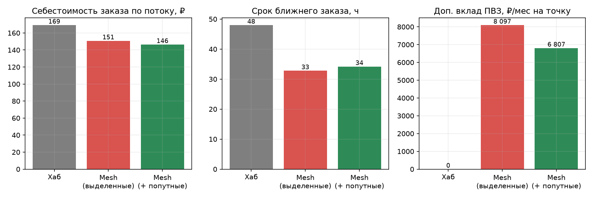
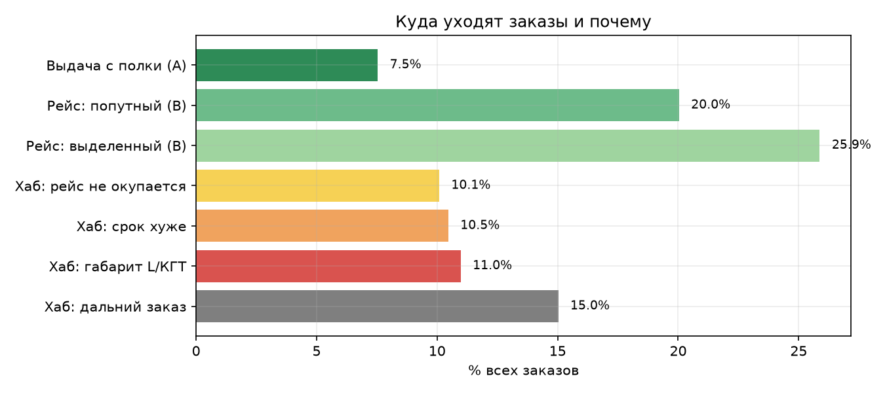
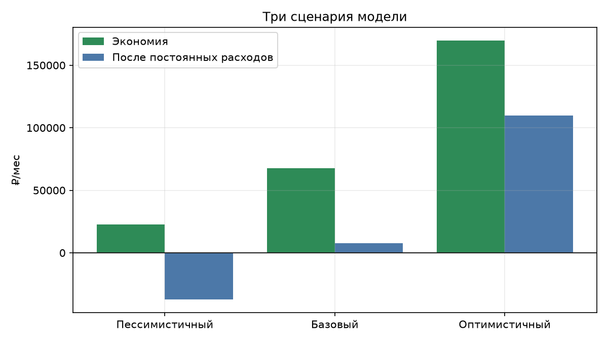
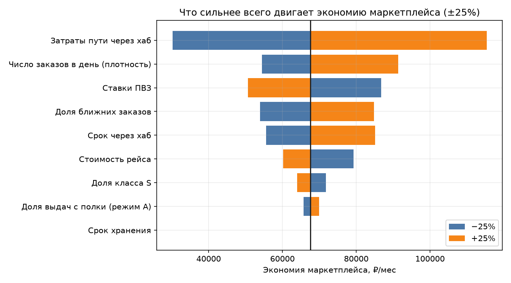
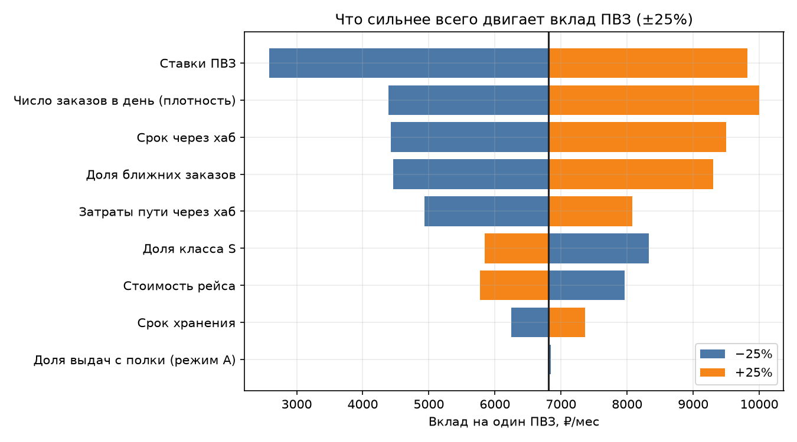
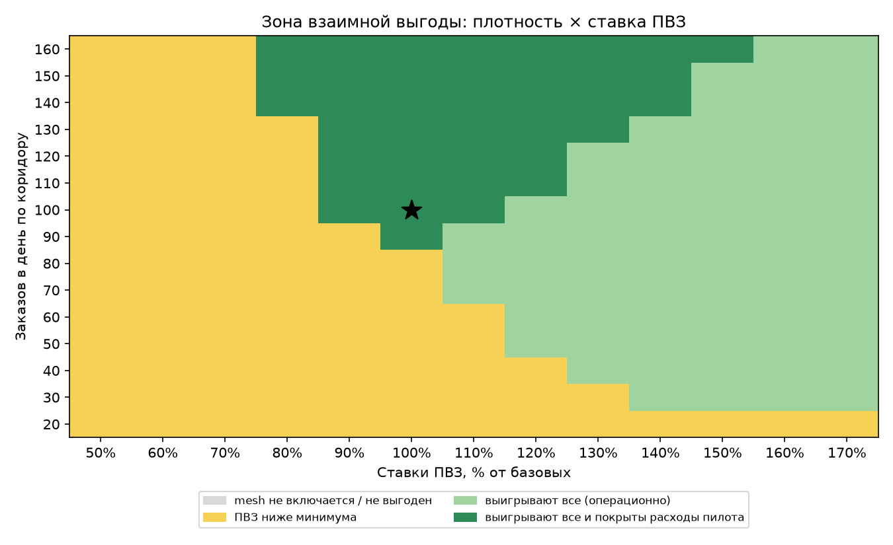

# Отчёт по модели: хаб против mesh на синтетических данных

> [!IMPORTANT]
> Все входные числа — **допущения команды** (`core/parameters.py`), а не тарифы RWB.
> Отчёт создаётся скриптом `python -m scripts.build_report`; после смены допущений он пересчитывается целиком.

## 1. Что и на чём считали

| Параметр | Значение |
| --- | --- |
| Данные | Синтетические заказы, `seed` 1–5 (усреднение), без персональных данных |
| Период | 30 дней, около 2802 заказов (≈ 100 в день) |
| Сеть | 1 коридор, 2 города (120 км), 4 ПВЗ, 1 хаб, 4 рейса в неделю |
| Состав потока | S 60% · M 27% · L 8% · КГТ 5%; ближних заказов 85% |
| Режим A | 10% ближних заказов лежат в ПВЗ покупателя заранее |
| Сравнение | Один и тот же набор заказов проходит базовую схему (все через хаб) и mesh с четырьмя фильтрами |

Модель сравнивает **устранимые** затраты: статьи, одинаковые в обеих схемах (выдача, упаковка, комиссия),
не входят. Дальние заказы идут через хаб в обеих схемах (магистраль — заглушка 120 ₽).

## 2. Сравнение схем

| Показатель | Хаб (база) | Mesh: только выделенные рейсы | Mesh: + попутная загрузка |
| --- | ---: | ---: | ---: |
| Себестоимость заказа по потоку, ₽ | 169.3 | 150.8 | 146.5 |
| Экономия маркетплейса, ₽/мес | — | 54 801 | 67 607 |
| Экономия, % к базе | — | 10.9% | 13.5% |
| После постоянных расходов пилота (60 000 ₽/мес) | — | −5 199 | 7 607 |
| Доля заказов через mesh | 0% | 59.9% | 53.5% |
| Срок ближнего заказа, ч | 48 | 32.8 | 34.2 |
| Цена доставки для покупателя | без изменений | без изменений | без изменений |
| Доп. вклад ПВЗ, ₽/мес на точку | 0 | 8 097 | 6 807 |
| Замороженный капитал продавца, ₽/мес (только эффект скорости) | — | 525 | 476 |
| Рейсов в месяц: выделенных / попутных | — | 14 / 0 | 6 / 10 |
| Заказов в выделенном рейсе (среднее) | — | 103 | 121 |

**Читать так.** Маркетплейс экономит около 13% на всём потоке (на ближнем потоке
экономия выше, но он составляет лишь часть заказов). Покупатель получает ближний заказ в среднем на
14 ч быстрее без изменения цены. ПВЗ получает дополнительный вклад.
Продавцу по тарифам добавляется **ноль** (в первые 3 дня он платит как в базе), его выгода только в скорости:
эффект конверсии не моделируется (нет данных), поэтому оценка для продавца занижена.

## 3. Куда уходят заказы и почему

| Причина | Заказов, % потока |
| --- | ---: |
| Выдача с полки (режим A) | 7.5% |
| Рейс попутный / выделенный (режим B) | 20.0% / 25.9% |
| Хаб: дальний заказ | 15.0% |
| Хаб: габарит L / КГТ | 11.0% |
| Хаб: срок mesh хуже срока хаба | 10.5% |
| Хаб: рейс не окупается | 10.1% |

Фильтры работают как задумано: примерно половина потока остаётся на хабе, потому что для неё mesh
не выгоден. Именно это показывает границы применимости схемы.

## 4. Три сценария

| Сценарий | Зона | Экономия, ₽/мес | % к базе | После пост. расходов | Вклад ПВЗ на точку | Срок, ч |
| --- | --- | ---: | ---: | ---: | ---: | ---: |
| Пессимистичный | YELLOW | 22 581 | 6.3% | −37 419 | 5 371 | 36.8 |
| Базовый | GREEN | 67 607 | 13.5% | 7 607 | 6 807 | 34.2 |
| Оптимистичный | GREEN | 169 914 | 25.6% | 109 914 | 8 481 | 30.7 |

Пессимистичный: рейс +25%, затраты хаба −15%, заказов −25%, ближних −10%, ставки ПВЗ +15%, доля режима A вдвое меньше.
Оптимистичный: зеркально. Диапазон помогает показать, **где** схема работает, а не обещать один результат.

## 5. Чувствительность (±25%)

| Параметр | −25%, ₽/мес | +25%, ₽/мес | Размах |
| --- | ---: | ---: | ---: |
| Затраты пути через хаб | 30 192 | 115 378 | 85 186 |
| Число заказов в день (плотность) | 54 470 | 91 371 | 36 901 |
| Ставки ПВЗ | 86 764 | 50 611 | 36 153 |
| Доля ближних заказов | 53 899 | 84 839 | 30 941 |
| Срок через хаб | 55 566 | 85 115 | 29 549 |
| Стоимость рейса | 79 227 | 60 170 | 19 058 |
| Доля класса S | 71 827 | 64 023 | 7 805 |
| Доля выдач с полки (режим A) | 65 742 | 69 941 | 4 198 |
| Срок хранения | 67 607 | 67 607 | 0 |

База: 67 607 ₽/мес. Сильнее всего результат зависит от параметра «Затраты пути через хаб»
(размах 85 186 ₽), затем «Число заказов в день (плотность)» (36 901 ₽).

Параметр «Срок хранения» на экономию маркетплейса не влияет: хранение оплачивается одинаково в обеих схемах, но он меняет вклад ПВЗ. 

## 6. Зона взаимной выгоды

Ось X — ставки ПВЗ относительно базовых, ось Y — число заказов в день по коридору. Звезда — базовая точка.
«Выигрывают все» значит: экономия маркетплейса положительна, вклад ПВЗ не ниже 5 000 ₽/мес,
цена и срок покупателя не хуже, продавец не платит больше. Таких ячеек 109 из 195,
из них 39 покрывают и постоянные расходы пилота.

## 7. Выводы

1. Mesh даёт **13.5%** экономии по потоку и ускоряет ближний заказ на 14 ч при прежней цене.
2. Результат после постоянных расходов пилота: выделенные рейсы — −5 199 ₽/мес, с попутной загрузкой — 7 607 ₽/мес. Выделенные рейсы сами пилот не окупают, попутная загрузка переводит результат в плюс: это граница применимости.
3. Пессимистичный сценарий: зона YELLOW, результат −37 419 ₽/мес. Оптимистичный: экономия 26%, результат 109 914 ₽/мес. Диапазон широкий, поэтому запуск начинается с проверки реальных затрат.
4. **Главная неопределённость — параметр «Затраты пути через хаб»** (размах 85 186 ₽/мес). Его нужно заменить реальными данными в первую очередь.
5. ПВЗ получает около 6 807 ₽/мес на точку дополнительно. Это выше принятого минимума, но не «золотая жила».

> Почему при попутной загрузке доля mesh-заказов ниже, чем при одних выделенных рейсах: решатель максимизирует экономию, а не охват.
> Часть заказов остаётся на хабе, потому что их выгода не покрывает отдельную машину, а места на попутном рейсе ограничено.

## 8. Что модель не учитывает

- Эффект конверсии и снижения возвратов у продавца (нет данных): выгода продавца занижена.
- Бонусы и штрафы ПВЗ (бонус за срок +10%, 5% за продажу с полки): в симуляции выключены; на маркетплейс это добавит расходы.
- Неликвид, возвраты и вечерний пик: описаны в бизнес-модели и покрываются сценариями MVP, но не входят в расчёт потока.
- Один коридор и статичная зона на весь период; нет динамики спроса по SKU.
- Ёмкость подсобки учтена агрегатно (общий коэффициент), а не по каждому ПВЗ и дню.
- Стоимость хранения на хабе принята равной ставке ПВЗ (допущение).
