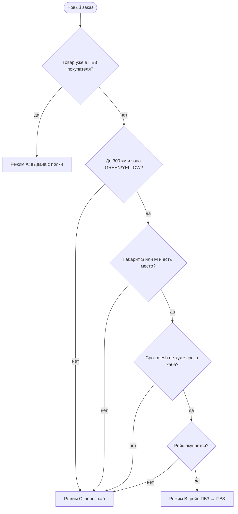
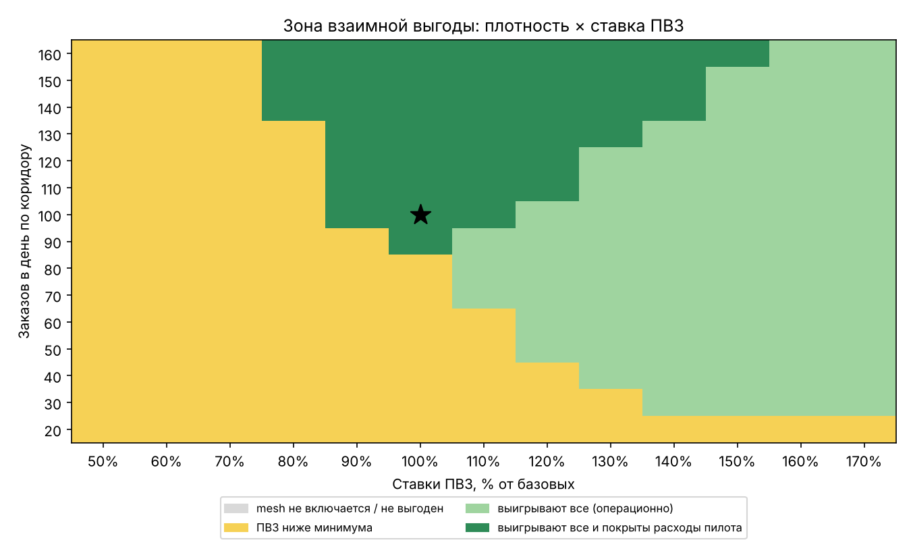

# rwbhak: mesh-доставка с хранением в ПВЗ

Модель выгодности и MVP полного цикла заказа. Студенческий хакатон Университета RWB и ПГТУ, 25–26 ноября 2026.

> [!IMPORTANT]
> Все цифры в проекте — **допущения команды**, а не тарифы RWB. Они собраны в одном месте
> ([`core/parameters.py`](core/parameters.py)), помечены единицами и пояснениями и меняются без правки логики.
> Данные синтетические, персональных данных нет.

## Идея

ПВЗ становится микро-складом ходовых товаров. Заказ внутри одной зоны выдаётся с полки ПВЗ или едет напрямую
ПВЗ → ПВЗ, минуя хаб и магистраль. Всё остальное идёт через хаб, как сейчас.

Mesh включается для заказа только если выполнены **четыре фильтра**: плотность района, габариты, срок и окупаемость рейса.
Если хотя бы один не пройден, заказ уходит через хаб. Покупатель не ждёт, пока наберётся машина.



## Результаты модели

Один поток из ~2 800 синтетических заказов (30 дней, 4 ПВЗ, 2 города, 4 рейса в неделю), одинаковый для обеих схем.
Все расчёты и цифры в одном файле: [**ANALYTICS.md**](ANALYTICS.md). Короткий отчёт с графиками: [`reports/model_report.md`](reports/model_report.md).

| Показатель | Хаб (база) | Mesh |
| --- | ---: | ---: |
| Себестоимость заказа по потоку | 169,3 ₽ | 146,5 ₽ |
| Экономия маркетплейса | — | 67 607 ₽/мес (13,5%) |
| Срок ближнего заказа | 48 ч | 34 ч |
| Цена доставки для покупателя | без изменений | без изменений |
| Доп. вклад ПВЗ | — | ≈ 6 800 ₽/мес на точку |
| Доля заказов через mesh | 0% | 53% |

**Границы применимости.** Выделенные рейсы сами пилот не окупают (−5 200 ₽/мес после постоянных расходов); результат даёт
попутная загрузка (+7 600 ₽/мес). В пессимистичном сценарии пилот убыточен, в оптимистичном экономия 26%. Самый чувствительный
параметр — стоимость пути через хаб: её нужно заменить реальными данными в первую очередь.



## Быстрый старт

Расчётное ядро и отчёт (Python 3.11+):

```bash
pip install -r requirements.txt
make breakeven     # пороги окупаемости (109, 50, 59, 66, 11, 77, 13)
make test          # 26 тестов на контрольные числа и поведение симулятора
make report        # пересчёт модели, графиков и reports/model_report.md
make analytics     # пересборка ANALYTICS.md (все расчёты и цифры)
make seed          # синтетические данные в data/
```

Backend, интерфейсы ПВЗ и продавца запускаются в Docker (`docker compose up --build`); состав и статус — ниже.

## Статус компонентов

| Компонент | Статус |
| --- | --- |
| Бизнес-модель ([`docs/business-model.md`](docs/business-model.md)) | Готово |
| Расчётное ядро `core/` и тесты | Готово |
| Симуляция схем, чувствительность, сценарии, карта взаимной выгоды | Готово |
| Контракт API ([`docs/api-contract.md`](docs/api-contract.md)) | Готово |
| Backend (FastAPI, БД, решатель заказа, ledger, рейсы) | В работе |
| Интерфейс ПВЗ с аналитикой стоимости и прибыли | В работе |
| Интерфейс продавца с прибылью по заказу | В работе |
| Docker Compose (db, api, ui) | В работе |

Обновляйте таблицу по мере готовности: незаконченное не выдаётся за сделанное.

## Структура

```
├── core/            # формулы, параметры, симуляция, анализ (без БД и UI)
├── api/             # backend (FastAPI)
├── ui/              # интерфейсы ПВЗ, продавца, «Модель»
├── data/            # генератор синтетики (seed = 42)
├── tests/           # pytest
├── scripts/         # сборка отчёта
├── reports/         # результаты модели, графики, results.json
├── docs/            # бизнес-модель, ТЗ, контракт API, структура презентации
├── README.md
└── AI_USAGE.md
```

## Пять сценариев (воспроизведение)

| № | Сценарий | Как проверить |
| --- | --- | --- |
| 1 | Городской заказ через mesh | [`docs/tz-backend.md`](docs/tz-backend.md#3-пять-сценариев-последовательность-вызовов-и-ожидаемые-числа), тест `tests/test_scenarios.py` (пишет backend, задача T4–T7) |
| 2 | Заказ через хаб и магистраль | то же, сценарий 2 |
| 3 | Возврат | то же, сценарий 3 |
| 4 | Ошибка в логистике | то же, сценарий 4 |
| 5 | Долгое хранение | то же, сценарий 5 |

## Документы

- [Бизнес-модель](docs/business-model.md) — тарифы, юнит-экономика, пилот, риски
- [**ANALYTICS.md**](ANALYTICS.md) — вся аналитика: допущения, формулы с подстановкой, имитационная модель, результаты, выводы
- [Отчёт по модели](reports/model_report.md) — сравнение схем, сценарии, чувствительность
- [ТЗ на MVP](docs/mvp-spec.md) · [ТЗ backend](docs/tz-backend.md) · [ТЗ frontend](docs/tz-frontend.md) · [Контракт API](docs/api-contract.md)
- [Структура презентации](docs/presentation-checkpoint1.md)

## Допущения и ограничения

- Допущения не подтверждены данными RWB; реестр доступен в `GET /params` и в [`core/parameters.py`](core/parameters.py).
- Выгода продавца занижена: эффект конверсии не моделируется, учтена только скорость.
- Бонусы и штрафы ПВЗ, возвраты и вечерний пик в потоке симуляции не учтены (они покрываются сценариями MVP).
- Магистраль, платёжный шлюз, управление хабом и приложение покупателя заменены заглушками или не реализуются (п. 7.3 регламента).

## Команда и вклад

| Участник | Роль | Что сделал |
| --- | --- | --- |
| [Имя 1] | Аналитик, капитан | Бизнес-модель, расчётное ядро, симуляция, отчёт, презентация |
| [Имя 2] | Backend | [заполнить] |
| [Имя 3] | Frontend и инфраструктура | [заполнить] |

## Что создано в период хакатона

Весь репозиторий создан в период хакатона 25–26 ноября 2026. Ранее готовых решений задачи использовано не было.
Используемые библиотеки и инструменты ИИ раскрыты в [`AI_USAGE.md`](AI_USAGE.md).

## Лицензия

[выбрать лицензию; сторонние зависимости указаны в `requirements.txt` и сохраняют свои лицензии]
