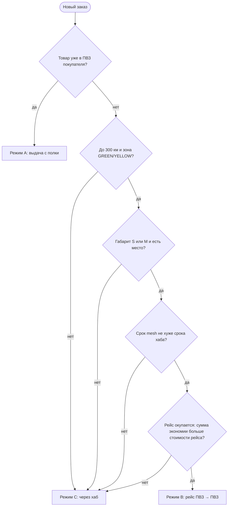
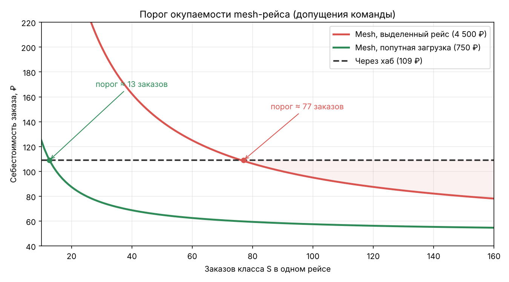

# Mesh-доставка с хранением в ПВЗ: бизнес-модель

[](#история-версий)
[](#)
[](#17-допущения-что-нужно-заменить-реальными-данными)

**Проект:** rwbhak · студенческий хакатон Университета RWB и ПГТУ, 25–26 ноября 2026
**Статус:** рабочая гипотеза, проверяется расчётами и прототипом в этом репозитории

> [!IMPORTANT]
> Все цифры в документе — **допущения команды**, а не тарифы RWB. Они взяты в разумных
> порядках величин, чтобы сравнить две схемы на одних и тех же заказах. Реальные данные
> подставляются в `core/parameters.py` без изменения логики.

## Кратко

**Идея.** ПВЗ становится микро-складом ходовых товаров. Заказ внутри одной зоны выдаётся
с полки ПВЗ или едет напрямую ПВЗ → ПВЗ, минуя хаб и магистраль. Всё остальное идёт через хаб
как сейчас. Mesh включается по четырём фильтрам: **плотность района, габариты, срок, стоимость рейса**.

| Вопрос | Ответ модели |
| --- | --- |
| Когда mesh выгоднее хаба? | Когда сумма экономии заказов в рейсе покрывает стоимость рейса |
| Порог выделенного рейса | ≈ 66 заказов (смешанный поток 70% S + 30% M) |
| Порог попутной загрузки | ≈ 11 заказов — ниже примерно в шесть раз |
| Экономия на заказе S до рейса | 59 ₽ (109 ₽ через хаб против 50 ₽ в mesh) |
| Вклад ПВЗ с заказа S | +15 ₽ (при 15 заказах в день ≈ 6 750 ₽/мес) |
| Где mesh не работает | Малый поток, крупногабарит, хрупкое, далёкая доставка |
| Пилот окупается | От ~120 заказов в рейс (выделенный) или ~62 (попутная загрузка) |

Связанные документы: [ТЗ на MVP](mvp-spec.md) · [Структура презентации](presentation-checkpoint1.md)

## Содержание

1. [Проблема и целевая метрика](#1-проблема-и-целевая-метрика)
2. [Гипотеза и её граница](#2-гипотеза-и-её-граница)
3. [Решение: три режима и четыре фильтра](#3-решение-три-режима-и-четыре-фильтра)
4. [Габариты заказа](#4-габариты-заказа)
5. [Фильтр 1: плотность района](#5-фильтр-1-плотность-района)
6. [Фильтр 2: срок доставки](#6-фильтр-2-срок-доставки)
7. [Участники и стимулы](#7-участники-и-стимулы)
8. [Тарифы](#8-тарифы)
9. [Юнит-экономика заказа](#9-юнит-экономика-заказа)
10. [Экономика ПВЗ](#10-экономика-пвз)
11. [Экономика пилота для маркетплейса](#11-экономика-пилота-для-маркетплейса)
12. [Неликвид, возвраты, сбои](#12-неликвид-возвраты-сбои)
13. [Критерий успеха пилота](#13-критерий-успеха-пилота)
14. [План пилота](#14-план-пилота)
15. [Риски](#15-риски)
16. [Масштабирование](#16-масштабирование)
17. [Допущения (что нужно заменить реальными данными)](#17-допущения-что-нужно-заменить-реальными-данными)

---

## 1. Проблема и целевая метрика

Маркетплейс упирается в три ограничения одновременно:

- **Хабы перегружены** — площади хранения растут медленнее потока, расширение стоит денег и времени.
- **Магистраль дорожает** — каждое плечо город → хаб → город оплачивается независимо от того, нужно ли оно.
- **В крупных городах продавец и покупатель часто рядом** — товар едет через хаб, чтобы вернуться в тот же город.

**Целевая метрика верхнего уровня:** себестоимость одного выданного заказа (₽/заказ) по всему
потоку — включая заказы через хаб, срывы рейсов, возвраты и непроданные остатки.

**Вторичные метрики:** загрузка хаба (%), доля заказов, обошедших хаб, доля выдач в срок,
прибыль ПВЗ, прибыль продавца, GMV (должен остаться неизменным — мы не растим продажи, мы
удешевляем их обслуживание).

---

## 2. Гипотеза и её граница

**Гипотеза:** часть товара выгодно держать не на хабе, а в подсобке ПВЗ, и возить напрямую
между ПВЗ — без заезда на хаб.

**Граница гипотезы:** mesh конкурентоспособен только на **ближней доставке — 2–3 соседних
города, до 300 км по дороге**. Дальше работает обычная схема через хаб.

Но расстояние — лишь первый фильтр. Mesh включается, когда одновременно выполнены **четыре
условия**:

| № | Фильтр | Вопрос |
| --- | --- | --- |
| 1 | **Плотность района** | Достаточно ли в зоне заказов и ПВЗ, чтобы рейсы не были пустыми? |
| 2 | **Габариты** | Подходит ли посылка по размеру и стоит ли занимать под неё место? |
| 3 | **Срок** | Дойдёт ли заказ не позже, чем через хаб? |
| 4 | **Стоимость** | Окупает ли рейс экономия на обходе хаба? |

Важная оговорка для защиты: **300 км — это граница пилота, а не доказанный порог
окупаемости**. Даже на 30 км отдельная машина ради одной посылки дороже хаба. Решение
принимают плотность, габариты, срок и цена конкретного рейса; расстояние лишь ограничивает
зону поиска.

---

## 3. Решение: три режима и четыре фильтра

ПВЗ становится **микро-складом**: небольшой запас ходовых товаров плюс обычная выдача.
Для каждого заказа решатель проверяет фильтры и выбирает режим.

| Режим | Когда срабатывает | Что происходит |
| --- | --- | --- |
| **A. Выдача с полки** | Товар уже лежит в ПВЗ покупателя | Резерв → выдача. Перевозки нет, срок минимальный |
| **B. Прямой рейс ПВЗ → ПВЗ** | Товар в соседнем ПВЗ, все фильтры пройдены | Сборка → рейс → выдача в ПВЗ покупателя |
| **C. Через хаб (базовая схема)** | Любой фильтр не пройден, сбой узла, другой регион | Обычная логистика маркетплейса |

Правило выбора (в коде — одна функция, параметры из конфига):

```
zone_ok   = zone_class in {GREEN, YELLOW}                 # фильтр 1: плотность района
size_ok   = size_class in {S, M} and not special_goods    # фильтр 2: габариты
space_ok  = pvz_free_um >= order_um                       # есть место в подсобке
time_ok   = eta_mesh <= eta_hub + delta_t                 # фильтр 3: срок
price_ok  = buyer_price_mesh <= buyer_price_hub           # цена для покупателя не растёт
trip_ok   = sum(saving_i for i in trip) >= trip_cost      # фильтр 4: рейс окупается

ship_mesh = (distance_km <= 300 and zone_ok and size_ok and space_ok
             and time_ok and price_ok and trip_ok)
# иначе — хаб
```



Ключевое правило: **если mesh не проходит хоть один фильтр, заказ уходит через хаб.**
Покупатель не ждёт, пока наберётся машина.

---

## 4. Габариты заказа

Размер посылки влияет на всё: сколько места она занимает в подсобке, сколько стоит обработка
и перевозка, помещается ли она в рейс. Вводим **условную единицу места (УМ)** и три класса.

| Класс | Пример | УМ | Коэф. операций `k_оп` | Коэф. перевозки `k_тр` | Допуск в mesh (пилот) |
| --- | --- | ---: | ---: | ---: | --- |
| **S** | Пакет, аксессуар, косметика | 1 | 1.0 | 1.0 | Да |
| **M** | Обувная коробка, небольшая техника | 3 | 1.3 | 1.5 | Да, при свободном месте |
| **L** | Крупная коробка, средняя техника | 8 | 1.8 | 2.5 | Нет, идёт через хаб |
| **КГТ / особые** | Мебель, хрупкое, жидкости, температурный режим | — | — | — | Нет, всегда хаб |

**Почему L и КГТ исключены из пилота.**

- Одна посылка L занимает 8 УМ из ~200 в подсобке (4% площади).
- Экономия mesh на единицу места падает с размером: S — 59 ₽/УМ, M — 31 ₽/УМ, L — 20 ₽/УМ
  (расчёт в разделе 9). Вклад ПВЗ на единицу места тоже падает (раздел 10).
- Хранение в mesh растёт пропорционально объёму, а перевозка через хаб — медленнее (крупные
  посылки возят экономичнее). Преимущество mesh на крупногабарите исчезает.

**Дополнительные ограничения по габаритам:**

- вместимость рейса — **300 УМ** (допущение, малая машина);
- доля M в подсобке — не более 50% от доступных УМ;
- класс посылки определяется по заявленным габаритам продавца; при расхождении при приёмке
  пересчитываются тариф и допуск.

---

## 5. Фильтр 1: плотность района

Рейс окупается только при достаточном потоке. Поэтому mesh включается не «по городу», а по
**зоне (коридору)** — паре районов или городов с ПВЗ на обоих концах.

Плотность зоны — это `λ`, число ближних заказов в день по коридору. Ожидаемый размер рейса:

```
заказов в рейсе = λ × интервал между рейсами
```

При 4 рейсах в неделю интервал ≈ 1,75 дня. Пороги берутся из раздела 9 (смешанный поток
70% S + 30% M):

| Зона | Условие по `λ` (заказов/день по коридору) | Что разрешено |
| --- | --- | --- |
| **GREEN** | ≥ 38 (хватает на отдельный рейс, ≥ 66 заказов) | Выделенные рейсы ПВЗ → ПВЗ + попутная загрузка |
| **YELLOW** | 7–38 (хватает только на приращение, ≥ 11 заказов) | Только попутная загрузка уже идущих рейсов |
| **RED** | < 7 | Только хаб |

Дополнительное условие: **минимум 2 ПВЗ со свободным местом на каждом конце коридора**, чтобы
был выбор и работал перенос заказа при сбое.

Зона пересчитывается по истории продаж раз в неделю. Новый коридор подключается только если
прогнозная `λ` выше порога: **сначала данные, потом расширение**.

---

## 6. Фильтр 2: срок доставки

Покупатель не должен терять во времени. Mesh выбирается, только если

```
eta_mesh ≤ eta_hub + delta_t        (в пилоте delta_t = 0, то есть «не хуже»)
```

Допущения по срокам (заменяются реальными данными):

| Схема | Срок |
| --- | --- |
| Через хаб, ближний поток | 48 ч |
| Mesh, режим A (с полки) | в день заказа, ≤ 4 ч |
| Mesh, режим B (рейс) | ожидание ближайшего рейса + 5 ч путь и выдача |

Примеры проверки режима B:

| До ближайшего рейса | ETA mesh | Против хаба (48 ч) | Решение |
| ---: | ---: | --- | --- |
| 6 ч | 11 ч | быстрее | Mesh |
| 30 ч | 35 ч | быстрее | Mesh |
| 44 ч | 49 ч | медленнее | Хаб |

Рейсы чаще и равномернее (например, через день) дают больше заказов, проходящих по сроку.

**Срок — условие допуска, а не критерий выбора.** Если выбирать mesh только потому, что он
быстрее, себестоимость может вырасти. Поэтому одного срока мало: заказ должен пройти и
фильтр стоимости. Цена доставки для покупателя при этом не меняется (тариф хаба), так что
ценовой риск целиком на маркетплейсе — отсюда обязательный фильтр 4.

---

## 7. Участники и стимулы

### Продавец

- **Что делает:** добровольно размещает пробную партию ходового товара (классы S и M).
- **Что видит до поставки:** тариф хранения, доступное место в ПВЗ, ожидаемый срок продажи,
  цену и порядок вывоза остатков.
- **Что получает:** близость к покупателю, более быстрый оборот, прозрачную прибыль по каждому
  заказу после комиссии, логистики, хранения и возвратов.
- **Чего боится и что мы закрываем:** «товар зависнет» → лимит партии по прогнозу продаж,
  алерты на 7-й день, гарантированный вывоз.

### Владелец ПВЗ

- **Что делает:** выделяет свободные места в подсобке и окна для складских операций.
- **Что получает:** оплату за приёмку, занятое место и сборку, бонус за продажу «со своей
  полки», бонус за выдачу в срок.
- **Чего боится и что мы закрываем:** очередь на выдаче в вечерний пик → складские операции
  только в тихих окнах (09:00–13:00, 20:00–22:00), право закрыть приёмку при перегрузке.

### Маркетплейс

- **Что делает:** организует рейсы, ведёт остатки, платит партнёрам, выбирает режим на каждый заказ.
- **Что получает:** снимает поток с хаба и убирает лишнее плечо.
- **Главное ограничение:** все выплаты ПВЗ и затраты на локальный транспорт — прямые расходы.
  Они не должны превышать **реально устранимые** затраты обычной схемы. Освобождённая площадь
  хаба — отдельный эффект, её нельзя записывать в денежную экономию.

### Покупатель

- **Что получает:** тот же ПВЗ, та же цена доставки, срок не хуже.
- **Чего не происходит:** его заказ не придерживают ради заполнения машины.

---

## 8. Тарифы

Ставки за операции масштабируются по габариту: `k_оп` (операции) и УМ (место).

### Для продавца

| Статья | Условие | Ставка (допущение) |
| --- | --- | --- |
| Хранение, дни 1–3 | включено | 0 ₽ |
| Хранение, дни 4–7 | за УМ-день | 3 ₽ |
| Хранение, дни 8–14 | за УМ-день | 6 ₽ |
| Хранение, дни 15+ | за УМ-день + вывоз | 10 ₽ + себестоимость рейса |
| Логистика | за выполненный заказ | базовый тариф маркетплейса, **без наценки за mesh** |

**Кто платит за приёмку и сборку.** Приёмку и сборку **оплачивает маркетплейс**, они входят в
вознаграждение ПВЗ (раздел 9) и не ложатся на продавца. Принцип: **в первые 3 дня продавец не
платит больше, чем при обычной схеме**. Дальше работает прогрессивный тариф хранения — он
стимулирует не держать неходовой товар и частично возвращает расходы маркетплейса.

> Допущение: в базовой схеме хранение сверх бесплатного срока тарифицируется аналогично.
> Если это не так, тариф дней 4+ нужно снижать, иначе mesh получится дороже для продавца.

### Для ПВЗ

| Операция | Ставка (допущение) |
| --- | --- |
| Приёмка единицы | 10 ₽ × `k_оп` |
| Хранение | 3 ₽ за УМ-день (выплата идёт с 1-го дня) |
| Сборка заказа | 21 ₽ × `k_оп` |
| Бонус за продажу со своей полки | 5% от выплаты за операции по этой единице |
| Бонус за выдачу в срок | +10% к выплате за заказ |
| Штраф: пересорт / порча | 100% стоимости товара |
| Штраф: пропущенное окно приёмки | 50 ₽ за инцидент |
| Штраф: превышение лимита мест | приёмка блокируется автоматически |

Выплата за хранение идёт ПВЗ **с первого дня**, хотя продавцу первые три дня бесплатны.
Разницу финансирует маркетплейс из экономии на хабе — это осознанная плата за то, чтобы ПВЗ
было выгодно держать товар, а не отказывать в приёмке.

---

## 9. Юнит-экономика заказа

Сравниваем **устранимые** затраты: статьи, одинаковые для обеих схем (выдача, упаковка,
эквайринг, комиссия), вычитаются с обеих сторон и на выбор не влияют.

### 9.1. Через хаб (₽ на заказ)

| Статья | S | M | L |
| --- | ---: | ---: | ---: |
| Обработка на хабе (25 ₽ × `k_оп`) | 25 | 32,5 | 45 |
| Хранение на хабе, 3 дня (3 ₽ × УМ × 3) | 9 | 27 | 72 |
| Плечо продавец → хаб (40 ₽ × `k_тр`) | 40 | 60 | 100 |
| Последняя миля хаб → ПВЗ (35 ₽ × `k_тр`) | 35 | 52,5 | 87,5 |
| **Итого** | **109** | **172** | **304,5** |

### 9.2. Mesh, без стоимости рейса (₽ на заказ)

| Статья | S | M | L |
| --- | ---: | ---: | ---: |
| Приёмка на ПВЗ (10 ₽ × `k_оп`) | 10 | 13 | 18 |
| Хранение в ПВЗ, 3 дня (3 ₽ × УМ × 3) | 9 | 27 | 72 |
| Сборка (21 ₽ × `k_оп`) | 21 | 27,3 | 37,8 |
| Прочее: возвраты, вывоз, резерв (10 ₽ × `k_оп`) | 10 | 13 | 18 |
| **Итого без рейса** | **50** | **80,3** | **145,8** |
| **Экономия до рейса** (хаб − mesh) | **59** | **91,7** | **158,7** |
| Экономия на УМ | 59 | 30,6 | 19,8 |

Экономия на единицу места убывает с габаритом — основание для ограничения классов в пилоте.

### 9.3. Стоимость рейса

Рейс между двумя городами, 120 км в одну сторону, 4 остановки, обратный путь включён:

| Статья | ₽ |
| --- | ---: |
| Пробег 240 км × 12 ₽/км | 2 880 |
| Работа водителя 6 ч × 270 ₽ (рейс + остановки + погрузка) | 1 620 |
| **Итого `C_trip`** | **4 500** |

**Попутная загрузка** (машина уже едет по плечу): сравниваем не весь рейс, а приращение —
крюк 40 км × 12 ₽ = 480 ₽ и остановка с погрузкой 1 ч × 270 ₽ = 270 ₽, итого **`C_inc` ≈ 750 ₽**.

### 9.4. Порог безубыточности рейса

Универсальное правило для любого состава рейса:

```
Σ (C_hub_i − C_mesh_var_i)  ≥  C_trip          (сумма экономии заказов в рейсе)
Σ УМ_i  ≤  300                                 (вместимость машины)
```

Для рейса только из S-заказов: `N_min = 4 500 / 59 ≈ 77 заказов`.

| Заказов S в рейсе | Mesh, ₽/заказ | Через хаб | Решение | Эффект за рейс |
| ---: | ---: | ---: | --- | ---: |
| 30 | 200 | 109 | Хаб | −2 730 ₽ |
| 60 | 125 | 109 | Хаб | −960 ₽ |
| 77 | ≈108 | 109 | Порог | ≈0 ₽ |
| 100 | 95 | 109 | Mesh | +1 400 ₽ |
| 150 | 80 | 109 | Mesh | +4 350 ₽ |



*Рис. 1. Себестоимость заказа S в зависимости от числа заказов в рейсе. Допущения — в разделе 17.*

Для смешанного потока **70% S + 30% M** средняя экономия 68,8 ₽ на заказ:

| Режим | Порог в заказах на рейс |
| --- | ---: |
| Выделенный рейс (`C_trip` = 4 500 ₽) | **≈ 66** |
| Попутная загрузка (`C_inc` = 750 ₽) | **≈ 11** |

Вывод для защиты: **одно и то же расстояние, разная загрузка и состав — разный ответ.**
Поэтому решение принимается на каждый рейс, а не «включением mesh по региону». Попутная
загрузка снижает порог примерно в шесть раз — это самый реалистичный старт.

---

## 10. Экономика ПВЗ

Расчёт на одну единицу, проданную на третий день:

| Статья | S | M | L |
| --- | ---: | ---: | ---: |
| Приёмка | +10 | +13 | +18 |
| Хранение (3 дня) | +9 | +27 | +72 |
| Сборка | +21 | +27,3 | +37,8 |
| **Выручка ПВЗ** | **+40** | **+67,3** | **+127,8** |
| Труд (3 / 4 / 6 мин × 400 ₽/ч) | −20 | −26,7 | −40 |
| Расходники и место | −5 | −15 | −40 |
| **Вклад** | **+15** | **+25,6** | **+47,8** |
| Вклад на УМ-день | 5,0 | 2,8 | 2,0 |

Честная оценка: это **не золотая жила**. При обороте 15 единиц S в день вклад точки —
примерно **6 750 ₽/мес** плюс бонусы; 20–30 единиц в день дают 9–13 тыс. ₽/мес без роста
штата. Крупные посылки приносят больше рублей, но **занимают место в разы выгоднее
использовать под S** (вклад на УМ-день падает с 5,0 до 2,0) — ещё один довод в пользу
ограничения по габаритам.

Два ограничения в модели:

- **ПВЗ берёт столько, сколько выгодно ему**, а не сколько хочет маркетплейс — лимит мест
  (~200 УМ, резерв 15%, доступно ~170 УМ) и право закрыть окно.
- Расчёт вклада показывается ПВЗ **до** подключения; отказаться от SKU можно.

---

## 11. Экономика пилота для маркетплейса

Коридор: 2 города, 4 ПВЗ, 1 хаб, 4 рейса в неделю (4,3 недели в месяце), смешанный поток
70% S + 30% M. Постоянные расходы пилота (интеграция, поддержка, обучение) — **~60 000 ₽/мес**.

| Заказов в рейсе | Выделенный рейс, ₽/мес | После пост. расходов | Попутная загрузка, ₽/мес | После пост. расходов |
| ---: | ---: | ---: | ---: | ---: |
| 40 | −30 000 | −90 000 | +34 000 | −26 000 |
| 66 | ≈0 | −60 000 | +65 000 | +5 000 |
| 100 | +41 000 | −19 000 | +105 000 | **+45 000** |
| 120 | +65 000 | **+5 000** | +129 000 | +69 000 |
| 150 | +100 000 | **+40 000** | +165 000 | +105 000 |

Проверка вместимости: 150 заказов (105 S + 45 M) = 240 УМ ≤ 300 УМ.

> [!NOTE]
> Таблица выше — ручной расчёт одного коридора при фиксированном размере рейса. Полный прогон на синтетическом потоке (с фильтрами, габаритами, зонами и чувствительностью) находится в [отчёте по модели](../reports/model_report.md); его числа считаются кодом из `core/`.

**Честный вывод:** при выделенных рейсах пилот окупается только от **~120 заказов в рейс**.
При попутной загрузке — уже от **~62 заказов в рейс**. Один слабый коридор пилот не
окупает; окупаемость даёт либо плотная зона GREEN, либо переход на попутные рейсы. Это не
недостаток модели, а её граница применимости — именно её просит показать кейс.

---

## 12. Неликвид, возвраты, сбои

### Долгое хранение

| День | Действие |
| --- | --- |
| 1–3 | Бесплатно, обычный режим |
| 4–7 | Тариф растёт, продавец видит стоимость остатка в кабинете |
| 7 | Алерт «нет продаж», остановка пополнения по SKU |
| 8–14 | Повышенный тариф, предложение забрать остаток |
| 15+ | Вывоз ближайшим плановым рейсом на хаб, тариф 10 ₽/УМ-день, пополнение заблокировано |

Хранение всей партии распределяется на фактически проданные единицы — иначе модель показывает
прибыль там, где команда просто не посчитала остаток. Крупные классы (M) копят стоимость
хранения втрое быстрее на единицу, поэтому алерт для них приходит раньше.

### Возвраты

Возврат идёт обратным потоком: ПВЗ покупателя → ближайший плановый рейс → хаб → продавец.
Начисления пересчитываются: выплата за сборку сторнируется, хранение возврата тарифицируется
отдельно, продавец видит полную стоимость возврата до его оформления. Двойные списания
исключаются идемпотентностью операций и двойной записью в ledger.

### Сбои

| Сбой | Поведение системы |
| --- | --- |
| Курьер не доехал | Рейс перестраивается: соседний ПВЗ или ближайший хаб; заказ получает новый ETA, покупатель уведомлён |
| ПВЗ не вынес товар | Тайм-слот, повторный заход в этом же рейсе, штраф только при доказанной вине ПВЗ |
| Нет места в ПВЗ | Приёмка блокируется, заказ уходит в режим C |
| Габариты не совпали с заявленными | Пересчёт класса и тарифа, при L/КГТ — перенаправление на хаб |
| Срок не проходит (нет рейса вовремя) | Заказ уходит в режим C |
| Товар повреждён | Списание, компенсация покупателю, разбор с ПВЗ по акту |
| Дубль события | `Idempotency-Key` + ledger: повтор не создаёт второе начисление |

---

## 13. Критерий успеха пилота

Пилот считается успешным, если на **одинаковом потоке заказов** одновременно выполнено:

| Критерий | Цель |
| --- | --- |
| Себестоимость заказа по всему потоку | −5% и лучше к базовой схеме |
| Цена доставки для покупателя | не выросла |
| Доля выдач в срок | не ниже базовой |
| Прибыль ПВЗ по новой схеме | положительная |
| Маржа продавца по заказу | не хуже базовой |
| GMV | без падения |
| Доля mesh-заказов в зонах GREEN/YELLOW | растёт, рейсы не ниже порога |

Это **цель проверки**, а не заранее объявленный результат. Если схема окупается только на
узком сегменте (зона GREEN, классы S и M), показываем границы и не расширяем пилот за них.

---

## 14. План пилота

| Параметр | Значение |
| --- | --- |
| География | 2 города-партнёра, расстояние ≤ 300 км, зона GREEN или YELLOW |
| Точки | 4 ПВЗ (по 2 в городе) + 1 хаб |
| Ассортимент | 30–50 компактных SKU классов S и M без особых условий хранения |
| Партия | по прогнозу продаж на 3–5 дней, не больше |
| Длительность | 4 недели |
| Рейсы | 4 в неделю + попутная загрузка |
| Контроль | сравнение с контрольной группой заказов через хаб на том же потоке |

**Порядок запуска:** 1 неделя — данные и интеграция → 2 недели — работа с запасом и рейсами →
1 неделя — разбор и решение о тиражировании.

---

## 15. Риски

| Риск | Как закрываем |
| --- | --- |
| Полупустые рейсы | Фильтр плотности (зоны), порог по сумме экономии, fallback на хаб |
| Лишние остановки и простои курьера | Ограничение числа точек на рейс, тайм-слоты, штрафы за срыв окна |
| Нехватка площади в ПВЗ | Лимит УМ с резервом 15%, доля M ≤ 50%, блокировка приёмки |
| Крупные и хрупкие посылки | Классы L/КГТ и особые товары идут только через хаб |
| Затягивание срока ради заполнения машины | Фильтр срока: `eta_mesh ≤ eta_hub`, иначе хаб |
| Вечерний пик на выдаче | Складские операции только в тихих окнах |
| Неликвид и зависшие партии | Прогрессивный тариф, алерты, вывоз на 15-й день |
| Возвраты и дубли начислений | Обратный поток по расписанию, двойная запись, идемпотентность |
| Товар на полке не продаётся | Отбор SKU по локальной плотности спроса, малые партии |
| ПВЗ работает в убыток | Расчёт вклада до подключения, право отказаться от SKU |
| Заявленные габариты не совпадают | Проверка при приёмке, пересчёт класса и тарифа |

---

## 16. Масштабирование

1. **Пилот** — один коридор, ручное подтверждение рейсов, 4 ПВЗ, фильтры по правилам из
   конфига.
2. **Регион** — 3–5 коридоров, автоматический пересчёт зон GREEN/YELLOW/RED, прогноз спроса
   по каждому ПВЗ.
3. **Сеть** — mesh только внутри кластеров ≤ 300 км, между кластерами обычная магистраль;
   лишние остатки стягиваются на хаб по расписанию.
4. **Технически** — решатель выносится в отдельный сервис, добавляются кэш остатков,
   очередь событий и наблюдаемость (метрики рейсов, SLA, алерты).

**Возможность развития: умное правило выбора.** В пилоте решатель применяет фиксированные
фильтры. На следующем этапе его можно заменить на динамический выбор по каждому заказу:
система сама взвешивает стоимость, срок, габарит и свободное место и выбирает между выдачей
из ПВЗ, рейсом ПВЗ → ПВЗ и хабом, учитывая текущую загрузку сети. Это точнее, но требует
накопленных данных и сложнее в сопровождении, поэтому в пилот не входит.

Главное правило масштабирования: **сначала данные, потом расширение**. Новый коридор
подключается, только если на исторических данных прогнозируемая загрузка выше порога.

---

## 17. Допущения (что нужно заменить реальными данными)

1. Устранимые затраты базовой схемы для класса S — **109 ₽/заказ** (обработка 25, хранение 9, плечо до хаба 40, последняя миля 35); для M — 172 ₽, для L — 304,5 ₽.
2. Стоимость рейса 4 500 ₽ (240 км × 12 ₽/км + 6 ч × 270 ₽); приращение при попутной загрузке — 750 ₽.
3. Ставки ПВЗ: 10 ₽ приёмка, 3 ₽ за УМ-день, 21 ₽ сборка (умножаются на `k_оп` для приёмки и сборки).
4. Классы габаритов: S = 1 УМ, M = 3 УМ, L = 8 УМ; коэффициенты `k_оп` = 1,0 / 1,3 / 1,8, `k_тр` = 1,0 / 1,5 / 2,5.
5. Вместимость рейса — 300 УМ; ёмкость подсобки — около 200 УМ при резерве 15%.
6. Средний срок хранения — 3 дня, доля возвратов — 5%.
7. Труд сотрудника ПВЗ — 400 ₽/час, 3 / 4 / 6 минут на операции для S / M / L.
8. Ставка хранения на хабе принята равной ставке в ПВЗ (3 ₽/УМ-день).
9. Сроки: через хаб 48 ч; mesh из рейса — ожидание рейса + 5 ч.
10. Состав потока пилота: 70% S, 30% M; 4 рейса в неделю; 4,3 недели в месяце.
11. Пороги плотности: GREEN от 38 заказов/день по коридору, YELLOW от 7 (следуют из пунктов 2 и 10).
12. В базовой схеме хранение сверх бесплатного срока тарифицируется аналогично mesh.
13. Спрос на локальный SKU — 1–4 единицы в день на точку.

Все параметры вынесены в конфиг и меняются без правки логики; в MVP они отображаются на
экране допущений, чтобы жюри видело, откуда взялись числа.


---

## История версий

| Версия | Изменения |
| --- | --- |
| 0.2 | Исправлена арифметика базовой схемы (109 ₽ вместо 150 ₽) и пересчитаны пороги и пилот. Добавлены фильтры плотности района и срока, учёт габаритов, уточнено, кто платит за приёмку и сборку. «Умное правило» вынесено в масштабирование |
| 0.1 | Первая рабочая гипотеза для чекпоинта 1 |
